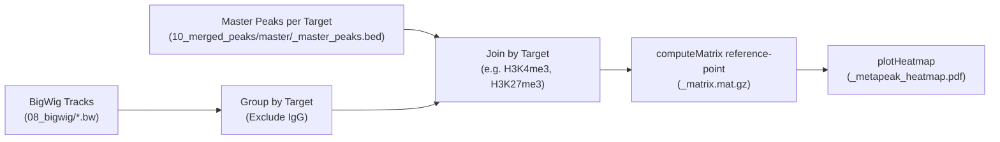

# Making Metapeak Plots (Tornado Plots)

This guide explains how the CUT&RUN pipeline generates metapeak plots (also known as **tornado plots** and average profile plots) using `deepTools` (`computeMatrix` and `plotHeatmap`), how to run or re-run just the metapeak plotting step, and how to customize the visual appearance, sorting, clustering, and sample labels.

---

## 1. How Metapeak Plots Work in This Pipeline

- Metapeak plotting is implemented in [`nf-cutandrun/modules/local/deeptools_metapeak/main.nf`](../nf-cutandrun/modules/local/deeptools_metapeak/main.nf)
- and configured via [`nf-cutandrun/conf/modules.config`](../nf-cutandrun/conf/modules.config) and [`Analysis_Run/config/experiment.config`](../Analysis_Run/config/experiment.config).

### Input Files

The metapeak step takes two sets of inputs (loaded directly from Dropbox and `Analysis_Run/results/`) plus the sample metadata in [`Analysis_Run/config/samplesheet.csv`](../Analysis_Run/config/samplesheet.csv):

```text
1. BigWig Signal Tracks (controlled by params.bigwig_source: "06_index_bam" or "08_bigwig")
   ${params.input_dir}/${params.bigwig_source}/
   ├── *.bw
   │   ├── L9254-0001-0001_S141_L004.bw     (EV_INT_H3K4me3)
   │   ├── L9254-0001-0002_S142_L004.bw     (EV_INT_H3K27me3)
   │   ├── L9254-0001-0003_S143_L004.bw     (EV_INT_IgG — automatically excluded)
   │   ├── L9254-0001-0004_S66_L008.bw      (N2_H3K4me3)
   │   ├── L9254-0001-0005_S67_L008.bw      (N2_H3K27me3)
   │   └── L9254-0001-0006_S68_L008.bw      (EV_INT_MC_H3K4me3)
   - "06_index_bam": BigWigs generated with `bamCoverage -b SAMPLE.bam --normalizeUsing RPKM -o SAMPLE.bw`
   - "08_bigwig":    BigWigs generated with `bedGraphToBigWig "$UNZIPPED_BG" "$CHROM_SIZES" "$BIGWIG_OUT"`

2. Master Peak Regions per Target (input_peaks_bed = "${params.outdir}/10_merged_peaks/master/*_master_peaks.bed")
   Analysis_Run/results/<experiment>/10_merged_peaks/master/
   ├── *_master_peaks.bed
   │   ├── H3K4me3_master_peaks.bed
   │   └── H3K27me3_master_peaks.bed

3. Sample Metadata
   Analysis_Run/config/samplesheet.csv
```



### Automatic Grouping by Histone Mark / Target
Based on [`Analysis_Run/config/samplesheet.csv`](../Analysis_Run/config/samplesheet.csv):
- **`H3K4me3` Tornado Plot (`H3K4me3_metapeak_heatmap.pdf`):** Plots signal from `EV_INT_H3K4me3`, `N2_H3K4me3`, and `EV_INT_MC_H3K4me3` centered on the regions in `H3K4me3_master_peaks.bed`.
- **`H3K27me3` Tornado Plot (`H3K27me3_metapeak_heatmap.pdf`):** Plots signal from `EV_INT_H3K27me3` and `N2_H3K27me3` centered on the regions in `H3K27me3_master_peaks.bed`.

### Two-Stage `deepTools` Execution
Inside [`nf-cutandrun/modules/local/deeptools_metapeak/main.nf`](../nf-cutandrun/modules/local/deeptools_metapeak/main.nf), two commands run sequentially:
1. **`computeMatrix reference-point`** (`ext.args`): Calculates coverage scores per genomic bin across a window (`-b` upstream, `-a` downstream) around each peak's reference point (`center`, `TSS`, or `TES`) and saves a compressed matrix (`<target>_matrix.mat.gz`).
2. **`plotHeatmap`** (`ext.args2`): Renders the top metapeak summary line plot and the bottom per-peak heatmap (`<target>_metapeak_heatmap.pdf`) from the compressed matrix.

---

## 2. Output Files

All metapeak outputs are published to:
```text
Analysis_Run/results/<experiment>/13_metapeak_plots/
├── H3K4me3_matrix.mat.gz
├── H3K4me3_metapeak_heatmap.pdf
├── H3K27me3_matrix.mat.gz
└── H3K27me3_metapeak_heatmap.pdf
```

---

## 3. Running Only the Metapeak Plot Step

If you have already generated your master peak files (`10_merged_peaks/master/*_master_peaks.bed`), you can run **only** the metapeak step in seconds/minutes by turning off the other toggles in [`Analysis_Run/config/experiment.config`](../Analysis_Run/config/experiment.config):

```groovy
// Choose which Dropbox BigWig directory to plot ('06_index_bam' or '08_bigwig')
bigwig_source                  = "06_index_bam"

// Turn off other peak analysis steps
run_macs2_callpeak             = false
run_homer_findpeaks            = false
run_merge_replicate_peaks      = false
run_merge_master_peaks         = false
run_homer_annotatepeaks        = false
run_homer_diffpeaks            = false
run_homer_findmotifs           = false
run_meme_streme                = false

// Enable ONLY metapeak plotting
run_deeptools_metapeak         = true

// Pre-existing inputs used automatically when upstream toggles are false:
input_bigwig                   = "${params.input_dir}/${params.bigwig_source}/*.bw"
input_peaks_bed                = "${params.outdir}/10_merged_peaks/master/*_master_peaks.bed"
```

Then run from `Analysis_Run/`:
```bash
./run.sh
```

---

## 4. Standard Configuration Parameters

In [`Analysis_Run/config/experiment.config`](../Analysis_Run/config/experiment.config), the following built-in parameters control `computeMatrix` and `plotHeatmap`:

| Parameter | Default | `deepTools` Flag | Description |
| :--- | :--- | :--- | :--- |
| `metapeak_upstream` | `2000` | `-b 2000` | Base pairs upstream of the reference point to plot. |
| `metapeak_downstream` | `2000` | `-a 2000` | Base pairs downstream of the reference point to plot. |
| `metapeak_reference_point` | `"center"` | `--referencePoint center` | Alignment point for each interval (`center`, `TSS`, or `TES`). |
| `heatmap_colormap` | `"inferno"` | `--colorMap inferno` | Matplotlib colormap name (`inferno`, `viridis`, `magma`, `Blues`, `RdYlBu_r`, etc.). |
| `heatmap_interpolation` | `"nearest"` | `--interpolationMethod nearest` | Pixel interpolation (`nearest`, `bilinear`, `bicubic`, `auto`). |

### Example: Wider Window ($\pm 5\text{ kb}$) for Broad `H3K27me3` Domains
Because `H3K27me3` forms broader domains than `H3K4me3` or transcription factors, you may want to expand the window to $\pm 5000\text{ bp}$ and switch the color palette:
```groovy
metapeak_upstream              = 5000
metapeak_downstream            = 5000
metapeak_reference_point       = "center"
heatmap_colormap               = "viridis"
heatmap_interpolation          = "nearest"
```

---

## 5. Advanced Customizations (Overriding in `Analysis_Run/config/experiment.config`)

To customize additional `deepTools` flags without modifying the core Nextflow pipeline (`conf/modules.config`), add a `process` override block at the bottom of `Analysis_Run/config/experiment.config` (outside the `params { ... }` block):
- `ext.args` overrides flags passed to **`computeMatrix reference-point`**
- `ext.args2` overrides flags passed to **`plotHeatmap`**

Below are common recipes you can place at the bottom of `Analysis_Run/config/experiment.config`.

### A. Sorting Peaks by a Specific Sample (`--sortUsingSamples`)
By default, `plotHeatmap` sorts rows by the mean signal across all samples in the matrix. To sort all columns by the intensity of the **first** sample (1-based index):
```groovy
process {
    withName: 'DEEPTOOLS_METAPEAK' {
        ext.args2 = {
            [
                "--colorMap ${params.heatmap_colormap}",
                "--interpolationMethod ${params.heatmap_interpolation}",
                "--sortRegions descend",
                "--sortUsing mean",
                "--sortUsingSamples 1"
            ].join(' ')
        }
    }
}
```

### B. Grouping Peaks with $k$-Means or Hierarchical Clustering (`--kmeans` / `--hclust`)
To partition peaks into distinct signal clusters (for example, peaks shared across strains vs. strain-specific peaks):
```groovy
process {
    withName: 'DEEPTOOLS_METAPEAK' {
        ext.args2 = {
            [
                "--colorMap ${params.heatmap_colormap}",
                "--interpolationMethod ${params.heatmap_interpolation}",
                "--kmeans 3"   // Or "--hclust 3"
            ].join(' ')
        }
    }
}
```

### C. Fixing the Color Scale (`--zMin` / `--zMax`) and Profile Y-Axis (`--yMin` / `--yMax`)
To enforce identical color scale limits across samples:
```groovy
process {
    withName: 'DEEPTOOLS_METAPEAK' {
        ext.args2 = {
            [
                "--colorMap ${params.heatmap_colormap}",
                "--interpolationMethod ${params.heatmap_interpolation}",
                "--zMin 0",
                "--zMax 50",
                "--yMin 0",
                "--yMax 40"
            ].join(' ')
        }
    }
}
```

### D. Customizing Bin Size and Missing Data in `computeMatrix`
By default, `computeMatrix` uses `10 bp` bins (`--binSize 10`). For wider windows ($\pm 5\text{ kb}$ or $\pm 10\text{ kb}$), increasing `--binSize` speeds up matrix computation and smooths the profile, while `--skipZeros` and `--missingDataAsZero` clean up empty regions:
```groovy
process {
    withName: 'DEEPTOOLS_METAPEAK' {
        ext.args = {
            [
                "-a ${params.metapeak_downstream}",
                "-b ${params.metapeak_upstream}",
                "--referencePoint ${params.metapeak_reference_point}",
                "--binSize 25",
                "--missingDataAsZero",
                "--skipZeros"
            ].join(' ')
        }
    }
}
```

