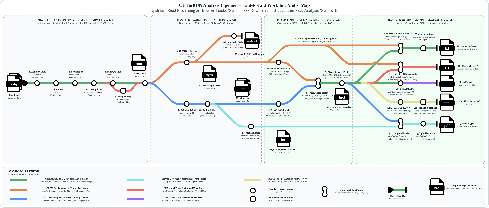

# Page 1: CUT&RUN Analysis Pipeline — High-Level Overview

**End-to-End Nextflow Workflow: From Aligned Chromatin Profiling Reads to Biological Discovery**



### Architecture Highlights
- **Two-Stage Modular Design:**
  - **Phases 1–2 (Upstream HPC → Dropbox):** Adapter trimming (`Trimmomatic`), alignment (`Bowtie2`), deduplication (`Picard`), MAPQ filtering (`samtools`), indexed BAMs (`06_index_bam/`), HOMER tag directories & UCSC tracks (`07_homer/`), and BigWig signal tracks (`08_bigwig/{deepTools,UCSC}/`).
  - **Phases 3–4 (Downstream Peak Analysis — `Cut_And_Run_Analysis`):** Peak calling, replicate consensus merging, gene annotation, differential binding, tornado heatmaps, motif discovery, and automated QC summary figures (`Steps c–i`).
- **Smart Execution Controls:** Every step has an independent boolean toggle (`run_*`) in `config/experiment.config` with automatic fallback to pre-existing outputs (`input_*`) when upstream steps are disabled.
- **Target-Aware Grouping:** Samples are automatically grouped by histone mark or transcription factor (`target` in `samplesheet.csv`), while `IgG` negative controls are automatically filtered out of target peak calling and heatmaps.

---

# Page 2: Inputs & Phase 3 — Peak Calling & Merging (Steps `c`–`d`)

### 1. Upstream Dropbox Inputs (`${params.input_dir}`)
| Input Directory | Contents | Downstream Steps Fed |
| :--- | :--- | :--- |
| **`06_index_bam/*.bam` (+ `.bai`)** | Coordinate-sorted, deduplicated, MAPQ-filtered paired-end BAMs | **Step `c1`:** `MACS2_CALLPEAK` |
| **`07_homer/tag_dir/<sample_id>/`** | Sample HOMER Tag Directories (`makeTagDirectory`) | **Steps `c2`, `e`, `f`:** `HOMER` Peak Calling, Annotation & DiffPeaks |
| **`08_bigwig/{deepTools,UCSC}/*.bw`** | Normalized coverage tracks (`bigwig_source = "deepTools"` or `"UCSC"`) | **Step `g`:** `DEEPTOOLS_METAPEAK` Tornado Plots |

---

### 2. Step `c`: Per-Sample Peak Calling (`09_peaks/`)
- **Step `c1` — `MACS2_CALLPEAK` (`run_macs2_callpeak`):**
  - Calls narrow peaks (`-f BAMPE -g ce -q 0.01`) or broad domains (`macs2_broad = true`) directly from paired-end BAMs.
  - **Outputs:** `09_peaks/macs2/<sample_id>_peaks.narrowPeak` (or `.broadPeak`), `_peaks.xls`, `_summits.bed`.
- **Step `c2` — `HOMER_FINDPEAKS` (`run_homer_findpeaks`):**
  - Calls factor (`-style factor`) or histone (`-style histone`) peaks from HOMER tag directories and converts to BED via `pos2bed.pl`.
  - **Outputs:** `09_peaks/homer/<sample_id>_peaks.txt` and `<sample_id>_peaks.bed`.
  - *Note:* `active_peak_caller = "macs2"` (or `"homer"`) selects which caller feeds into Step `d`.

---

### 3. Step `d`: Replicate Filtering & Master Peak Consensus (`10_merged_peaks/`)
- **Step `d1` — `BEDTOOLS_MERGE_REPLICATES` (`run_merge_replicate_peaks`):**
  - Groups sample peaks by biological **`condition`**, sorts and merges overlapping intervals (`bedtools merge -c 4 -o count_distinct`), and keeps only peaks reproducibly present in $\ge$ `min_replicate_overlap` replicates (default `2`).
  - **Output:** `10_merged_peaks/replicates/<condition>_replicated_peaks.bed`.
- **Step `d2` — `BEDTOOLS_MERGE_MASTER` (`run_merge_master_peaks`):**
  - Combines replicated peak sets across all conditions for the same **`target`** (e.g., `H3K4me3` or `H3K27me3`) into a unified coordinate dictionary so all samples are quantified across identical genomic intervals.
  - **Output:** `10_merged_peaks/master/<target>_master_peaks.bed`.

---

# Page 3: Phase 4 — Quantification, DiffPeaks & Tornado Plots (Steps `e`–`g`)

### 1. Step `e`: Peak-by-Peak Quantification & Gene Annotation (`HOMER_ANNOTATEPEAKS`)
- **Command:** `annotatePeaks.pl <target>_master_peaks.bed ce11 -size given -d <sample1_tagdir> <sample2_tagdir> ...`
- **What It Does:**
  - Assigns every master peak to its nearest Transcription Start Site (`Distance to TSS`), gene name/description, and genomic feature (`Promoter-TSS`, `Exon`, `Intron`, `TTS`, `Intergenic`).
  - Quantifies depth-normalized read density (fragments per $10\text{M}$ mapped reads) across each sample's HOMER tag directory (`07_homer/tag_dir/*`).
  - Includes helper script `bin/normalize_homer_peaks.py` for optional peak-width normalization ($\text{tags per kb}$).
- **Output:** `11_peak_quantification/<target>_annotated_peaks.txt`

---

### 2. Step `f`: Differential Peak Analysis (`HOMER_GETDIFFERENTIALPEAKS`)
- **Command:** `getDifferentialPeaksReplicates.pl -t <treatment_tagdirs...> -b <background_tagdirs...> -p <target>_master_peaks.bed -genome ce11 -all`
- **What It Does:**
  - Evaluates each contrast defined in `params.diff_contrasts` (e.g., `EV_INT_vs_N2_H3K4me3`) using DESeq2 across biological replicate tag directories.
  - Reports $\log_2$ fold changes, raw $p$-values, and Benjamini–Hochberg adjusted FDR values for every master peak.
- **Output:** `12_differential_peaks/<contrast_id>_differential_peaks.txt`

---

### 3. Step `g`: Metapeak Profiles & Tornado Heatmaps (`DEEPTOOLS_METAPEAK`)
- **Two-Stage `deepTools` Execution:**
  1. **`computeMatrix reference-point`:** Computes signal coverage across all non-IgG BigWig tracks (`08_bigwig/${params.bigwig_source}/*.bw`) within a configurable window (default $\pm 2000\text{ bp}$ around peak `center`).
  2. **`plotHeatmap`:** Renders top average metapeak profile curves above a sorted per-peak signal heatmap (`--colorMap inferno`).
- **Outputs:** `13_metapeak_plots/<target>_matrix.mat.gz` and `13_metapeak_plots/<target>_metapeak_heatmap.pdf`

---

# Page 4: Phase 4 — Motif Discovery, Summary Plots & Execution (Steps `h`–`i`)

### 1. Step `h`: Enriched DNA Sequence Motif Discovery (`14_motifs/`)
- **Step `h1` — `HOMER_FINDMOTIFSGENOME` (`run_homer_findmotifs`):**
  - Runs `findMotifsGenome.pl <target>_master_peaks.bed ce11 -size 100` to identify both **known** transcription factor binding motifs (`knownResults.html`) and ***de novo*** enriched sequence motifs (`homerResults.html`).
  - **Output:** `14_motifs/homer/<target>_homer_motifs/`
- **Step `h2` — `MEME_STREME` (`run_meme_streme`):**
  - Extracts peak centers (`awk`), expands $\pm 50\text{ bp}$ windows (`bedtools slop`), converts intervals to sequences (`bed2fasta`), and runs `streme --nmotifs 20 --dna`.
  - **Output:** `14_motifs/meme_streme/<target>_streme_motifs/streme.html`

---

### 2. Step `i`: Automated QC & Biological Summary Suite (`15_summary_plots/`)
Automatically generates publication-ready `.svg`, `.png`, and `.tsv` tables across five diagnostic categories:
1. **`01_peak_counts/` (`PLOT_PEAK_COUNTS`):** Bar chart comparing per-sample MACS2/HOMER peak counts, replicate-filtered counts, and master union counts.
2. **`02_genomic_features/` (`PLOT_ANNOTATED_SUMMARY`):** Stacked bar chart, donut chart, and TSS distance histogram (`Promoter-TSS`, `Exon`, `Intron`, `Intergenic`).
3. **`03_correlation_and_pca/` (`PLOT_ANNOTATED_SUMMARY`):** Pairwise Pearson correlation heatmap and PCA scatter plot on $\log_2(\text{Tag Count} + 1)$.
4. **`04_signal_distributions/` (`PLOT_ANNOTATED_SUMMARY`):** Violin/boxplots of raw tag counts vs. width-normalized density ($\text{tags/kb}$) plus peak width distributions.
5. **`05_differential_plots/` (`PLOT_DIFFERENTIAL_VOLCANO_MA`):** Volcano ($-\log_{10}\text{FDR}$ vs. $\log_2\text{FC}$) and MA plots with automated gene symbol labeling.

---

### 3. Running & Resuming the Pipeline
```bash
# 1. Configure experiment paths, bigwig_source ('deepTools' or 'UCSC'), and step toggles:
#    Analysis_Run/config/experiment.config & Analysis_Run/config/samplesheet.csv

# 2. Launch from Analysis_Run/ (automatically uses Nextflow -resume cache):
cd Analysis_Run && ./run.sh
```
