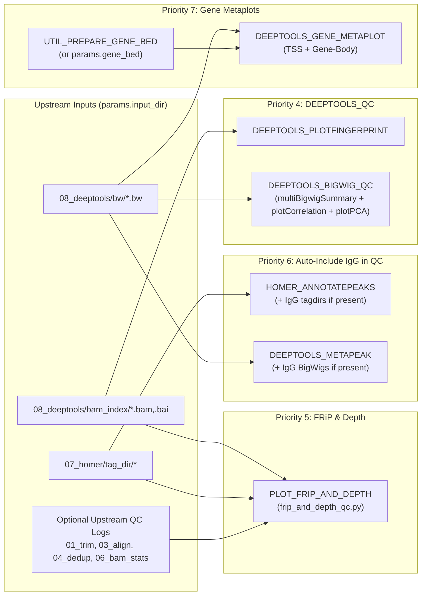

# Implementation Plan: Task 1 Automation Additions (`Cut_And_Run_Analysis`)

**Scope:** Priorities **4, 5, 6, and 7** from [`task_1.md`](../../task_1.md) — automating BigWig/BAM enrichment QC, FRiP + read-retention reporting, IgG inclusion in QC tracks, and TSS/gene-body metaplots inside `Cut_And_Run_Analysis`.

*(Priorities 1–3 — Trimmomatic/Bowtie2 log publishing, `SAMTOOLS_BAM_STATS` in `06_bam_stats/`, and `MULTIQC_ALL` — are already implemented upstream in `Cut_And_Run_Nextflow` and staged via `stage_results_dropbox.sh`.)*

---

## Architecture Overview & Directory Layout

All new outputs preserve existing `09_`–`15_` directory paths for backward compatibility and reuse the existing `deeptools:3.5.6` container (which bundles `deepTools`, `Python 3`, `matplotlib`, `numpy`, `scipy`, `pysam`, and `pyBigWig`).



### Published Output Paths (`conf/modules.config`)

| Priority | Process | Output Directory | Key Artifacts |
| :---: | --- | --- | --- |
| **4** | `DEEPTOOLS_PLOTFINGERPRINT` | `15_summary_plots/06_deeptools_qc/fingerprint/` | `*_fingerprint.{pdf,png}`, `*_fingerprint_metrics.tsv`, `*_fingerprint_counts.tsv` |
| **4** | `DEEPTOOLS_BIGWIG_QC` | `15_summary_plots/06_deeptools_qc/bigwig/` | `all_samples_bw_summary.npz`, `*_correlation_heatmap.{pdf,png}`, `*_correlation_matrix.tsv`, `*_pca.{pdf,png}`, `*_pca_data.tsv` |
| **5** | `PLOT_FRIP_AND_DEPTH` | `15_summary_plots/07_frip_and_depth/` | `frip_summary.tsv`, `read_retention_depth_summary.tsv`, `frip_comparison.{svg,png}`, `read_retention_funnel.{svg,png}` |
| **6** | `HOMER_ANNOTATEPEAKS` / `DEEPTOOLS_METAPEAK` | `11_peak_quantification/` & `13_metapeak_plots/` | Existing outputs automatically include IgG columns/tracks whenever IgG controls are present in `samplesheet.csv` |
| **7** | `DEEPTOOLS_GENE_METAPLOT` | `13_metapeak_plots/genes/` | `*_tss_{profile,heatmap}.pdf`, `*_genebody_{profile,heatmap}.pdf`, `*_matrix.mat.gz` |

---

## Cross-Cutting Prerequisite: Automatic Control Sample Resolution (`main.nf` & `lib/samplesheet.nf`)

QC and reporting must **not** depend on peak-calling config flags (such as `params.use_igg_control`) or a separate `include_controls_in_qc` toggle: **if IgG control sample(s) are present in `samplesheet.csv`, QC/reporting automatically uses them; if not, QC/reporting runs cleanly without them.**

Currently in `main.nf`:
- `ch_bam_bai` and `ch_tagdirs` only require IgG control IDs when `params.use_igg_control == true`.
- `ch_bigwig` only requires `sheet_ctx.non_igg_sample_ids`.

**Required update:**
1. In `lib/samplesheet.nf`, expose `control_sample_ids` (all rows where `isControlTarget(meta)` is true) and `all_sample_ids` in the returned `sheet_ctx` map.
2. In `main.nf`, always resolve all samples listed in `samplesheet.csv` (including any IgG control rows, regardless of `params.use_igg_control`):
   - Set `expectedIds: sheet_ctx.all_sample_ids` for `ch_bam_bai`, `ch_tagdirs`, and `ch_bigwig` (since any sample listed in `samplesheet.csv` should have its upstream BAM, tagDir, and BigWig present; if no IgG rows exist in `samplesheet.csv`, `all_sample_ids == non_igg_sample_ids`).
3. Add optional upstream QC log globs in `nextflow.config` (resolved with `checkIfExists: false`, never failing if absent on older upstream runs):
   - `input_trimmomatic_logs = "${params.input_dir}/01_trim/*_trimmomatic.log"`
   - `input_bowtie2_logs     = "${params.input_dir}/03_align/*_bowtie2.log"`
   - `input_picard_dup       = "${params.input_dir}/04_dedup/*_dup.txt"`
   - `input_bam_stats        = "${params.input_dir}/06_bam_stats/*"`

---

## Priority 6: Automatic IgG Inclusion in QC Tracks & Quantification (Implement First)

*Implementing Priority 6 first establishes the shared control-pairing helper reused by Priorities 4, 5, and 7. No config toggle is needed — behavior is driven purely by whether IgG controls exist in `samplesheet.csv`.*

### Goal
Automatically include IgG negative control tracks and tag counts alongside target samples in `HOMER_ANNOTATEPEAKS` and `DEEPTOOLS_METAPEAK` whenever IgG controls are present in the samplesheet, without altering peak calling, merging, differential analysis, or motif discovery.

### Changes
1. **`workflows/cutandrun.nf`**:
   - Add a helper to collect control tagdirs/BigWigs for each target:
     - Prefer IgG controls explicitly referenced by `meta.control_id` for samples of that target; if none are referenced, fall back to all IgG control samples in the run.
     - If no IgG control samples exist in the run, the helper returns an empty list (no-op).
   - **Step e (`HOMER_ANNOTATEPEAKS`):** Automatically append the matched IgG `tagdir`(s) (if any) to `tagdirs` for each target.
   - **Step g (`DEEPTOOLS_METAPEAK`):** Automatically append the matched IgG `bigwig`(s) (and their `sample_name`s, if any) to the **end** of each target's sorted BigWig list so IgG always renders as the rightmost reference column in the tornado plot.
   - **Unchanged steps:** `MACS2_CALLPEAK`, `HOMER_FINDPEAKS`, `BEDTOOLS_MERGE_REPLICATES`, `BEDTOOLS_MERGE_MASTER`, `HOMER_GETDIFFERENTIALPEAKS`, `HOMER_FINDMOTIFSGENOME`, and `MEME_STREME` continue filtering out IgG via `!isControlTarget(meta)` (and peak calling still respects `params.use_igg_control`).
2. **`bin/cutandrun_plot_utils.py` & `bin/plot_annotated_features_qc.py`**:
   - Verify `parse_homer_annotated_table()` maps IgG tagdir columns to `sample_name` and `condition` cleanly via `samplesheet.csv`.
   - Assign a consistent neutral slate/gray color (`#7F7F7F`) to IgG conditions in `build_condition_color_map()` so IgG is immediately visually distinguishable in Plot 3 (Correlation/PCA) and Plot 4 (Signal Distributions).

---

## Priority 4: `DEEPTOOLS_QC` Modules (`plotFingerprint`, `multiBigwigSummary`, `plotCorrelation`, `plotPCA`)

### Goal
Provide peak-independent enrichment QC (Subtasks 4 & 5) and genome-wide replicate/sample correlation + PCA (Subtask 6) across all samples including IgG and untagged controls.

### New Modules (Split for Parallelism & Caching)

#### 4A. `modules/local/deeptools/plotfingerprint/main.nf`
- **Container:** Same `deeptools:3.5.6` image as `DEEPTOOLS_METAPEAK`.
- **Label:** `process_medium`.
- **Input:**
  - `tuple val(meta), path(bams), path(bais)` where `meta` contains `id` (e.g., `'all_samples'` or target name) and ordered `sample_names`.
- **Command:**
  ```bash
  plotFingerprint \
      -b ${bams} \
      --labels ${meta.sample_names.join(' ')} \
      --extendReads \
      --skipZeros \
      --numberOfProcessors ${task.cpus} \
      --outQualityMetrics ${prefix}_fingerprint_metrics.tsv \
      --outRawCounts ${prefix}_fingerprint_counts.tsv \
      --plotFile ${prefix}_fingerprint.pdf \
      ${args}
  ```
  *(Also emit a `.png` or run a second lightweight render / convert if PNG is desired alongside PDF.)*
- **Outputs:** `pdf`, `metrics_tsv`, `raw_counts_tsv`, and `versions_deeptools` (topic `versions`).
- **Workflow wiring:** Run once across **all samples** (`id: 'all_samples'`, targets sorted by target/sample_name + IgG at the end). Optionally allow per-target + IgG runs if `fingerprint_per_target = true`.

#### 4B. `modules/local/deeptools/bigwig_qc/main.nf`
- **Container:** Same `deeptools:3.5.6` image.
- **Label:** `process_medium`.
- **Input:**
  - `tuple val(meta), path(bigwigs)` where `meta` contains `id: 'all_samples'` and ordered `sample_names`.
- **Command:**
  1. `multiBigwigSummary bins -b ${bigwigs} --labels ${labels} --binSize ${params.qc_bin_size} -p ${task.cpus} -o ${prefix}_bw_summary.npz --outRawCounts ${prefix}_bw_raw_counts.tsv`
  2. `plotCorrelation -in ${prefix}_bw_summary.npz --corMethod ${params.qc_cor_method} --skipZeros --removeOutliers --whatToPlot heatmap --colorMap RdYlBu_r --plotNumbers -o ${prefix}_correlation_heatmap.pdf --outFileCorMatrix ${prefix}_correlation_matrix.tsv`
  3. `plotPCA` (guarded in bash: run only when number of BigWigs $\ge 3$; if $< 3$, write a placeholder notice TSV so the process never fails on 2-sample experiments):
     `plotPCA -in ${prefix}_bw_summary.npz -o ${prefix}_pca.pdf --outFileNameData ${prefix}_pca_data.tsv`
- **Outputs:** `npz`, `raw_counts_tsv`, `corr_pdf`, `corr_matrix_tsv`, `pca_pdf` (optional), `pca_data_tsv` (optional), and `versions_deeptools`.

### Config Parameters (`nextflow.config`)
*(Controlled by existing `run_summary_plots = true` — no separate toggle required.)*
```groovy
qc_bin_size             = 5000          // Bin size (bp) for multiBigwigSummary bins (ce11 ~100 Mb -> 20k bins)
qc_cor_method           = 'spearman'    // 'spearman' or 'pearson'
fingerprint_bin_size    = 500           // --binSize for plotFingerprint
fingerprint_num_samples = 500000        // --numberOfSamples for plotFingerprint
```

---

## Priority 5: FRiP + Read-Retention & Depth Summary

### Goal
Automate Subtasks 2 & 5 by computing exact **FRiP (Fraction of Reads in Peaks)** for targets vs. IgG and assembling an end-to-end **Read-Retention & Sequencing Depth** table + publication-grade SVG/PNG plots.

### New Files
1. **`bin/plot_frip_and_depth.py`** (Python 3.12+, strict type hints, dataclasses, SOLID separation of parsers / calculators / plotters, reusing `cutandrun_plot_utils.py`).
2. **`modules/local/python/plot_frip_and_depth/main.nf`** (reuses `deeptools:3.5.6` container, which includes `pysam`, `numpy`, `matplotlib`).

### Computation Design

#### A. FRiP Calculation (via `pysam` on indexed BAMs)
- **Denominator (`total_mapped_reads`):** Count mapped primary reads (`!is_unmapped && !is_secondary && !is_supplementary`, i.e., `-F 0x904`; or properly paired fragments `-f 0x2 -F 0x904` divided by 2) per BAM.
- **Numerator (`reads_in_peaks`):** Merge overlapping intervals per BED in memory, then query `bam.fetch(chrom, start, end)` (deduplicating reads spanning adjacent intervals by read name or interval sweep) to count reads overlapping peaks.
- **Peak sets evaluated:**
  1. **Per-sample FRiP:** Each experimental sample BAM against its own active peak BED (`ch_active_sample_peaks`).
  2. **Master-peak FRiP (Target vs. IgG):** Each experimental sample BAM **and** each IgG control BAM evaluated against each target's master peak BED (`ch_master_peaks`, or union of per-sample peaks per target when `run_merge_master_peaks = false`).
  - This directly yields an apples-to-apples **Target FRiP vs. IgG FRiP** comparison on the exact same peak set.

#### B. Read-Retention & Depth Aggregation (Graceful Degradation)
Parse all available upstream files matched by `sample_id`:

| Stage / Metric | Source File (if present) | Fallback if Absent |
| --- | --- | --- |
| Raw read pairs & Trim retention % | `01_trim/<id>_trimmomatic.log` | `NA` |
| Overall & concordant alignment % | `03_align/<id>_bowtie2.log` | Approx. rate from Picard `*_dup.txt` |
| Total dup %, Optical dup %, True PCR dup %, Est. library size | `04_dedup/<id>_dup.txt` | `NA` |
| Post-filter mapped reads, Properly paired %, `chrM` %, Mean insert size | `06_bam_stats/<id>.{flagstat,idxstats,stats}` | Computed directly from BAM via `pysam` |
| Final usable tags, `tagsPerBP`, `fragmentLengthEstimate` | `07_homer/tag_dir/<id>/tagInfo.txt` | `NA` |
| Final BAM size (MB) & Mean genome coverage ($\times$) | BAM `st_size` + `chrom.sizes` + fragment length | Always computed |

#### C. Outputs (`15_summary_plots/07_frip_and_depth/`)
- `frip_summary.tsv`: `sample_id, sample_name, condition, target, role, peak_set, total_fragments, fragments_in_peaks, frip_pct`
- `read_retention_depth_summary.tsv`: One row per sample with all retention stages, duplication breakdown, `chrM%`, BAM size, usable fragments, and estimated genome coverage ($\times$).
- `frip_comparison.{svg,png}`: Grouped horizontal/vertical bar chart comparing Target vs. IgG FRiP (%) per peak set, with subtle reference guide lines (e.g., 5% background / 10% enrichment).
- `read_retention_funnel.{svg,png}`: Multi-panel figure:
  - Panel A: Read-pair retention across pipeline stages (Raw → Trimmed → Mapped → Dedup → Final MAPQ≥10).
  - Panel B: Duplication breakdown (Unique vs. Optical Dup vs. True PCR Dup).
  - Panel C: Usable fragments (M), estimated genome coverage ($\times$), and `chrM%`.

### Config Parameters (`nextflow.config`)
Controlled by existing `run_summary_plots = true` (no separate toggle required).

---

## Priority 7: TSS-Centered and Gene-Body Metaplots (`DEEPTOOLS_GENE_METAPLOT`)

### Goal
Automate Subtask 4's genome-wide gene signal verification: sharp TSS enrichment for narrow active marks (`H3K4me3`), broad gene-body domains for repressive marks (`H3K27me3`), and flat baseline for `IgG`.

### Gene Annotation Strategy (Zero-Friction for `ce11`, Configurable for Any Genome)
- Add `params.gene_bed = null` in `nextflow.config`.
- **When `params.gene_bed` is provided:** Validate and pass directly to `DEEPTOOLS_GENE_METAPLOT`.
- **When `params.gene_bed == null`:** Run a fast `UTIL_PREPARE_GENE_BED` module (`bin/homer_rna_to_gene_bed.py`) on `${params.homer_dir}/data/genomes/${params.genome_name}/${params.genome_name}.rna` (already bundled at `assets/homer_ce11/data/genomes/ce11/ce11.rna`, 54,631 transcripts):
  - Convert HOMER `.rna` format (`transcript_id, chrom, start, end, strand, ...`) to 6-column BED (`chrom, start, end, name, 0, strand`), filtering to chromosomes present in `params.chrom_sizes` and excluding `chrM`.
  - Deduplicate identical `(chrom, start, end, strand)` intervals (and optionally collapse overlapping same-strand isoforms to the longest transcript per locus so multi-isoform genes do not dominate the metaplot).

### New Modules

#### 7A. `modules/local/python/util_prepare_gene_bed/main.nf` + `bin/homer_rna_to_gene_bed.py`
- **Label:** `process_single`; reuses `deeptools:3.5.6` container.
- **Input:** `path homer_rna`, `path chrom_sizes`.
- **Output:** `path "${genome_name}_genes.bed", emit: bed`.

#### 7B. `modules/local/deeptools/gene_metaplot/main.nf`
- **Container:** Same `deeptools:3.5.6` image.
- **Label:** `process_medium`.
- **Input:** `tuple val(meta), path(gene_bed), path(bigwigs)` — grouped per target (with IgG appended automatically whenever IgG controls are present in `samplesheet.csv`), plus an optional `'all_samples'` combined run.
- **Commands:**
  1. **TSS Reference-Point:**
     ```bash
     computeMatrix reference-point \
         --referencePoint TSS \
         -b ${params.gene_tss_upstream} \
         -a ${params.gene_tss_downstream} \
         -R ${gene_bed} \
         -S ${bigwigs} \
         --missingDataAsZero \
         --skipZeros \
         -p ${task.cpus} \
         -o ${prefix}_tss_matrix.mat.gz

     plotProfile \
         -m ${prefix}_tss_matrix.mat.gz \
         --perGroup \
         --samplesLabel ${labels} \
         --refPointLabel TSS \
         -o ${prefix}_tss_profile.pdf

     plotHeatmap \
         -m ${prefix}_tss_matrix.mat.gz \
         --samplesLabel ${labels} \
         --refPointLabel TSS \
         ${args2} \
         -o ${prefix}_tss_heatmap.pdf
     ```
  2. **Gene-Body Scale-Regions:**
     ```bash
     computeMatrix scale-regions \
         -b ${params.gene_body_upstream} \
         -a ${params.gene_body_downstream} \
         -m ${params.gene_body_length} \
         -R ${gene_bed} \
         -S ${bigwigs} \
         --missingDataAsZero \
         --skipZeros \
         -p ${task.cpus} \
         -o ${prefix}_genebody_matrix.mat.gz

     plotProfile \
         -m ${prefix}_genebody_matrix.mat.gz \
         --perGroup \
         --samplesLabel ${labels} \
         --startLabel TSS \
         --endLabel TES \
         -o ${prefix}_genebody_profile.pdf

     plotHeatmap \
         -m ${prefix}_genebody_matrix.mat.gz \
         --samplesLabel ${labels} \
         --startLabel TSS \
         --endLabel TES \
         ${args2} \
         -o ${prefix}_genebody_heatmap.pdf
     ```
- **Outputs:** `tss_matrix`, `tss_profile_pdf`, `tss_heatmap_pdf`, `genebody_matrix`, `genebody_profile_pdf`, `genebody_heatmap_pdf`, and `versions_deeptools`.

### Config Parameters (`nextflow.config`)
*(Controlled by existing `run_summary_plots = true` — no separate toggle required.)*
```groovy
gene_bed              = null    // Optional custom BED/GTF; auto-derived from HOMER <genome>.rna if null
gene_tss_upstream     = 2000
gene_tss_downstream   = 2000
gene_body_upstream    = 2000
gene_body_downstream  = 2000
gene_body_length      = 3000
```

---

## Phased Implementation Order

| Phase | Deliverables | Files Touched / Created |
| :---: | --- | --- |
| **1** | Auto control resolution + **Priority 6** (auto-include IgG in QC when present) | `lib/samplesheet.nf`, `main.nf`, `workflows/cutandrun.nf`, `bin/cutandrun_plot_utils.py` |
| **2** | **Priority 4** (`DEEPTOOLS_PLOTFINGERPRINT` + `DEEPTOOLS_BIGWIG_QC`) | `modules/local/deeptools/plotfingerprint/main.nf`, `modules/local/deeptools/bigwig_qc/main.nf`, `conf/modules.config`, `nextflow.config`, `workflows/cutandrun.nf` |
| **3** | **Priority 5** (`PLOT_FRIP_AND_DEPTH` + `plot_frip_and_depth.py`) | `bin/plot_frip_and_depth.py`, `modules/local/python/plot_frip_and_depth/main.nf`, `conf/modules.config`, `nextflow.config`, `workflows/cutandrun.nf`, `main.nf` |
| **4** | **Priority 7** (`UTIL_PREPARE_GENE_BED` + `DEEPTOOLS_GENE_METAPLOT`) | `bin/homer_rna_to_gene_bed.py`, `modules/local/python/util_prepare_gene_bed/main.nf`, `modules/local/deeptools/gene_metaplot/main.nf`, `conf/modules.config`, `nextflow.config`, `workflows/cutandrun.nf` |
| **5** | Docs & experiment config template updates | `docs/Example_Run/config/experiment.config`, `docs/USERS_GUIDE.md`, `docs/process_map.md` |

---

## Verification Plan

1. **Stub dry-run (`-stub-run`):**
   - Run `nextflow run main.nf -stub-run` against a test experiment config with `run_summary_plots = true` to verify channel wiring, `publishDir` paths, and `software_mqc_versions.yml` collation.
2. **Python unit tests:**
   - Test `bin/homer_rna_to_gene_bed.py` against `assets/homer_ce11/data/genomes/ce11/ce11.rna` and `chrom.sizes` (verify 6-column BED format, strand values `+/-`, `start < end`, no `chrM`, and deduplicated coordinates).
   - Test `bin/plot_frip_and_depth.py` with mock/real `01_trim`, `03_align`, `04_dedup`, `06_bam_stats`, and `tagInfo.txt` inputs, including a missing-logs fallback case (graceful `NA` handling).
3. **End-to-end validation on `cut_run103026B` / `Analysis_Run_D`:**
   - Confirm `EV_INT_IgG` appears as the rightmost track in `13_metapeak_plots/*_metapeak_heatmap.pdf` and in `11_peak_quantification/*_annotated_peaks.txt`.
   - Confirm `plotFingerprint` shows H3K4me3 bowing sharply below the diagonal, H3K27me3 moderately bowed, and IgG near the diagonal.
   - Confirm `frip_summary.tsv` reports high FRiP for `EV_INT_H3K4me3` / `EV_INT_H3K27me3` and low background FRiP for `EV_INT_IgG` on the same master peak sets.
   - Confirm `13_metapeak_plots/genes/*_tss_profile.pdf` shows sharp TSS peaks for `H3K4me3` and `*_genebody_profile.pdf` shows broad gene-body signal for `H3K27me3` over flat `IgG`.
4. **Edge-case checks:**
   - Samplesheet **without** any IgG rows (ensure all 4 additions succeed without error).
   - Experiment with **only 2 samples** (ensure `plotPCA` guard in `DEEPTOOLS_BIGWIG_QC` exits cleanly).
   - `run_merge_master_peaks = false` (ensure `PLOT_FRIP_AND_DEPTH` still computes per-sample FRiP and target-level union FRiP).
