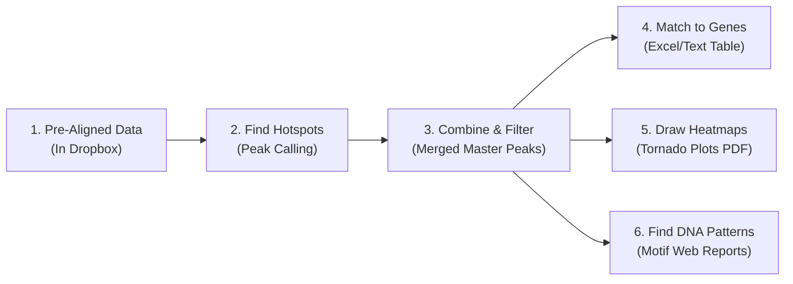

# CUT&RUN Pipeline Tutorial for Non-Scientists

This guide explains **what the CUT&RUN Peak Analysis Pipeline does**, **how to run it**, **which settings you might want to change**, and **how to read the results**—without requiring a background in bioinformatics or programming.

---

## 1. The Big Picture: What Does This Pipeline Do?

### The Everyday Analogy
Imagine a cell's DNA (the **genome**) as a massive instruction library containing thousands of recipes (**genes**). Inside the cell, certain proteins and chemical tags (**histone marks** or **transcription factors**) act like **bookmarks** or **sticky notes**:
- Some bookmarks (like **`H3K4me3`**) acts as "OPEN / ACTIVE" signs placed right at the start of active recipes.
- Other bookmarks (like **`H3K27me3`**) act as "DO NOT USE" tape spread across whole chapters to silence them.

**CUT&RUN** is a lab technique that cuts out only the pieces of DNA right where a specific bookmark is attached. After the DNA pieces are sequenced and aligned to the genome (which is already done for you in Dropbox), you have millions of tiny DNA coordinates.

**This pipeline takes those aligned DNA coordinates and answers five questions:**
1. **Where are the bookmarks concentrated?** (*Peak Calling* — finding "hotspots" or **peaks** of signal along the DNA)
2. **Which hotspots are reliable across repeat experiments?** (*Peak Merging* — combining replicates and building a master list of hotspots)
3. **Which genes are next to these hotspots, and how strong is the signal in each sample?** (*Peak Quantification & Annotation* — generating a master spreadsheet)
4. **What does the signal look like visually across all hotspots at once?** (*Metapeak / Tornado Plots* — generating heatmaps and summary curves)
5. **Do these hotspots share a recurring DNA spelling pattern?** (*Motif Discovery* — finding DNA letter patterns where proteins like to bind)



---

## 2. How to Run the Pipeline (Step-by-Step)

### Before You Start (3 Quick Checks)
1. **Docker Desktop is running:** Look for the whale icon in your Mac's top menu bar. (Docker packages all the scientific software automatically so you never have to install tools by hand.)
2. **Dropbox files are available offline:** In Finder, navigate to your experiment folder in Dropbox (for example, `Bioinformatics_parent/cut_run103026`), right-click the folder, and select **"Make available offline"**. If files are online-only placeholders (`0 bytes`), the pipeline will warn you and skip them.
3. **Open a Terminal** in the project root folder (`Cut_And_Run_Analysis/`).

---

### Step 1: Check Your Sample Sheet (`Analysis_Run/config/samplesheet.csv`)
The file [`Analysis_Run/config/samplesheet.csv`](../Analysis_Run/config/samplesheet.csv) tells the pipeline what each file in Dropbox actually represents. You can edit it in any text editor or Excel (save as CSV):

```csv
sample_id,sample_name,condition,target,replicate,control_id
L9254-0001-0001_S141_L004,EV_INT_H3K4me3,EV_INT_H3K4me3,H3K4me3,1,L9254-0001-0003_S143_L004
L9254-0001-0002_S142_L004,EV_INT_H3K27me3,EV_INT_H3K27me3,H3K27me3,1,L9254-0001-0003_S143_L004
L9254-0001-0003_S143_L004,EV_INT_IgG,EV_INT_IgG,IgG,1,
L9254-0001-0004_S66_L008,N2_H3K4me3,N2_H3K4me3,H3K4me3,1,
L9254-0001-0005_S67_L008,N2_H3K27me3,N2_H3K27me3,H3K27me3,1,
L9254-0001-0006_S68_L008,EV_INT_MC_H3K4me3,EV_INT_MC_H3K4me3,H3K4me3,1,L9254-0001-0003_S143_L004
```

| Column | Plain-English Meaning | Example |
| :--- | :--- | :--- |
| **`sample_id`** | The exact filename prefix from the sequencing facility (before `.bam` or `.bw`). | `L9254-0001-0001_S141_L004` |
| **`sample_name`** | A human-friendly label that will appear on your plots. | `EV_INT_H3K4me3` |
| **`condition`** | The experimental group name. Samples with the **same** `condition` are treated as biological replicates of each other. | `EV_INT_H3K4me3` |
| **`target`** | The protein or histone mark being measured. The pipeline automatically groups analyses by `target` (e.g., all `H3K4me3` samples together, all `H3K27me3` samples together). | `H3K4me3`, `H3K27me3`, or `IgG` |
| **`replicate`** | Repeat number (`1`, `2`, `3`, etc.). | `1` |
| **`control_id`** | Optional `sample_id` of the negative control (`IgG`) sample. | `L9254-0001-0003_S143_L004` |

> [!NOTE]
> **How `IgG` (Negative Control) Samples Are Handled:** Any row where `target` is `IgG` is automatically recognized as a background control and excluded from target peak calling, master peak merging, and tornado plots so it doesn't pollute your real biological signal.

---

### Step 2: Preview and Run the Pipeline
From the main project folder (`Cut_And_Run_Analysis/`), use the built-in `make` commands defined in [`Makefile`](../Makefile):

1. **Check that your settings and files are valid (Dry Run):**
   ```bash
   make test
   ```
   *This checks your configuration syntax and previews which steps will run without actually running any heavy computations.*

2. **Run the pipeline:**
   ```bash
   make run
   ```
   *(Alternatively, from inside `Analysis_Run/`, you can run `./run.sh`.)*

> [!TIP]
> **Smart Resume (`-resume`):** The pipeline automatically remembers steps it has already finished. If you change one plot setting and run `make run` again, it will skip the 20-minute steps that didn't change and only re-run the 30-second plotting step!

---

## 3. Common Parameters to Change

All settings live in one file: [`Analysis_Run/config/experiment.config`](../Analysis_Run/config/experiment.config). Below are the most common adjustments you might make depending on your experiment.

### A. Pointing to a New Experiment Folder
When starting a new experiment, update the top block of `experiment.config`:
```groovy
email          = "your.name@umassmed.edu"
experiment     = "cut_run103026"   // Folder name inside Dropbox Bioinformatics_parent/
```
*Your results will automatically be saved to `Analysis_Run/results/<experiment>/`.*

---

### B. Turning Pipeline Steps On or Off (`true` / `false`)
Every major step has an on/off switch in `experiment.config`. If you already ran the pipeline once and only want to tweak a plot, you can set earlier steps to `false` so only the step you care about runs:

| Parameter | Default | What It Controls |
| :--- | :--- | :--- |
| `run_macs2_callpeak` | `true` | **Step c:** Finds hotspots (peaks) using the MACS2 algorithm (best general-purpose caller). |
| `run_homer_findpeaks` | `false` | **Step c:** Finds hotspots using the HOMER algorithm (alternative peak caller). |
| `run_merge_replicate_peaks` | `true` | **Step d1:** Filters peaks across replicates within the same condition. |
| `run_merge_master_peaks` | `true` | **Step d2:** Combines peaks from all conditions of the same target (`H3K4me3`, etc.) into one master peak list. |
| `run_homer_annotatepeaks` | `true` | **Step e:** Creates the master spreadsheet matching every peak to its nearest gene and signal level. |
| `run_homer_diffpeaks` | `false` | **Step f:** Statistically compares two conditions to find significantly gained/lost peaks. |
| `run_deeptools_metapeak` | `true` | **Step g:** Generates the Tornado Plot (heatmap + average profile PDF). |
| `run_homer_findmotifs` | `true` | **Step h1:** Searches peaks for enriched DNA sequence patterns (motifs) using HOMER. |
| `run_meme_streme` | `false` | **Step h2:** Searches peaks for enriched DNA sequence patterns using MEME STREME. |

---

### C. Adjusting for Number of Replicates (`min_replicate_overlap`)
```groovy
run_merge_replicate_peaks = true
min_replicate_overlap     = 2
```
- **What it means:** How many replicates of the same condition must share a peak for that peak to be kept as "real."
- **When to change it:**
  - **If you have 2 or 3 replicates per condition:** Keep `min_replicate_overlap = 2` (a peak must appear in at least 2 replicates to filter out random one-off noise).
  - **If you only have 1 replicate per condition:** Either set `min_replicate_overlap = 1` **or** set `run_merge_replicate_peaks = false` (the pipeline automatically detects single-replicate conditions and keeps their peaks, but setting `min_replicate_overlap = 1` makes your intent explicit).

---

### D. Narrow vs. Broad Marks (Sharp Spikes vs. Wide Blankets)
Different proteins bind DNA in different shapes:
- **Narrow marks** (like `H3K4me3` or transcription factors) form sharp, tight spikes (a few hundred base pairs wide).
- **Broad marks** (like `H3K27me3` or `H3K36me3`) spread across wide genomic regions (thousands of base pairs wide).

| Parameter | For Narrow / Sharp Marks (`H3K4me3`, TFs) | For Broad / Spreading Marks (`H3K27me3`) | Plain-English Effect |
| :--- | :--- | :--- | :--- |
| `macs2_broad` | `false` | `true` | Tells MACS2 to link nearby signal into wider domains instead of splitting them into tiny spikes. |
| `macs2_qvalue` | `0.01` | `0.01` (or `0.05` if too strict) | Statistical strictness (False Discovery Rate). Smaller number = stricter (fewer, higher-confidence peaks). |
| `homer_peak_style` | `"factor"` | `"histone"` | Used if `run_homer_findpeaks = true`. |
| `metapeak_upstream` / `metapeak_downstream` | `2000` ($\pm 2\text{ kb}$) | `5000` ($\pm 5\text{ kb}$) | Controls how wide the window is on the Tornado Plot around each peak center. |

---

### E. Customizing Tornado Plots (Metapeak Heatmaps)
In `experiment.config`, you can adjust the look and data source of your tornado plots:
```groovy
bigwig_source             = "06_index_bam"  // '06_index_bam' (RPKM normalized) or '08_bigwig' (UCSC bedGraph)
metapeak_upstream         = 2000            // Distance (in DNA letters/bp) to show to the left of peak center
metapeak_downstream       = 2000            // Distance (in DNA letters/bp) to show to the right of peak center
metapeak_reference_point  = "center"        // Align peaks by their 'center', 'TSS' (start), or 'TES' (end)
heatmap_colormap          = "inferno"       // Color palette: 'inferno', 'viridis', 'magma', 'Blues', 'RdYlBu_r'
```
- **Which `bigwig_source` should I pick?**
  - `"06_index_bam"` *(Recommended default)*: Uses RPKM-normalized tracks where signal is scaled for sequencing depth so samples with more or fewer total reads can be compared fairly.
  - `"08_bigwig"`: Uses tracks converted directly from HOMER UCSC bedGraphs.

*(For advanced Tornado Plot tweaks—like sorting rows by a specific sample, fixing the color bar min/max, or grouping peaks into clusters—see [`MAKING_METAPEAK_PLOTS.md`](MAKING_METAPEAK_PLOTS.md)).*

---

## 4. What to Look For in Your Results

All outputs are saved inside `Analysis_Run/results/<experiment>/` in numbered folders that match the order of analysis:

```text
Analysis_Run/results/cut_run103026/
├── 09_peaks/                  # Step c: Raw peaks found in each individual sample
├── 10_merged_peaks/           # Step d: Filtered replicate peaks & combined master peak lists
├── 11_peak_quantification/    # Step e: Master gene-annotated spreadsheet (open in Excel/R)
├── 12_differential_peaks/     # Step f: Statistical comparison between conditions (if enabled)
├── 13_metapeak_plots/         # Step g: Tornado plot PDFs (heatmaps + average curves)
├── 14_motifs/                 # Step h: Enriched DNA motif web reports
└── pipeline_info/             # Execution report, timeline, and software versions
```

---

### Folder 1: `09_peaks/` — Individual Sample Peaks
Contains the hotspots detected in each individual sample (`macs2/` or `homer/`).
- **Files you'll see:**
  - `<sample_id>_peaks.narrowPeak`: A text table listing every peak's chromosome, start, end, and statistical score.
  - `<sample_id>_summits.bed`: The single highest point (1 base pair) of each peak.
  - `<sample_id>_peaks.xls`: A tab-separated summary file you can open in Excel that includes the command settings and peak table.
- **What to look for:**
  - **Total number of peaks:** In *C. elegans*, a typical histone mark or transcription factor experiment yields anywhere from **a few hundred to ~15,000 peaks** depending on the target.
  - **Warning signs:** If a sample has **0–50 peaks**, the antibody may have failed or `macs2_qvalue` is too strict. If it has **>50,000 tiny peaks**, background noise may be high.

---

### Folder 2: `10_merged_peaks/` — Replicate & Master Peaks
- **`replicates/<condition>_replicated_peaks.bed`**: Peaks that were reproducibly found across your replicates for a single condition.
- **`master/<target>_master_peaks.bed`**: The unified "dictionary" of all peak regions for a given target (e.g., `H3K4me3_master_peaks.bed` combines all `H3K4me3` conditions; `H3K27me3_master_peaks.bed` combines all `H3K27me3` conditions).
- **What to look for:**
  - Make sure `H3K4me3_master_peaks.bed` and `H3K27me3_master_peaks.bed` are not empty! Every downstream step (spreadsheet, tornado plot, motifs) uses these master peak coordinates so that all samples for the same target are measured at the exact same genomic locations.

---

### Folder 3: `11_peak_quantification/` — The Master Gene & Signal Spreadsheet
- **Files you'll see:** `H3K4me3_annotated_peaks.txt`, `H3K27me3_annotated_peaks.txt`
- **How to open it:** Open Microsoft Excel (or Google Sheets / R) and import the `.txt` file as a **Tab-Delimited** table.
- **What each row represents:** One row = one peak from your master peak list.
- **Key columns to look at:**

| Column Name | What It Tells You | What to Look For |
| :--- | :--- | :--- |
| **`Chr`, `Start`, `End`** | The exact DNA coordinates of the peak. | Copy and paste `chrIV:1176876-1178554` into the IGV genome browser to inspect a peak visually. |
| **`Annotation`** | What kind of DNA region the peak landed in (`promoter-TSS`, `exon`, `intron`, `Intergenic`, `TTS`). | **Sanity check:** For `H3K4me3` (an active promoter mark), you should see a large fraction of peaks labeled **`promoter-TSS`**. |
| **`Distance to TSS`** | How many DNA letters away the peak is from the nearest gene's starting line (Transcription Start Site). | Numbers close to `0` (e.g., `-250` to `+250`) mean the peak sits right at the gene's promoter. |
| **`Gene Name` & `Gene Description`** | The common worm/human gene name (e.g., `col-94`, `pgp-1`) and a plain-English description of what that gene does. | Helps you immediately spot biologically relevant genes in your experiment. |
| **`<sample_id> Tag Count...` (Last Columns)** | **The normalized signal strength** (fragments per 10 million mapped reads) for each sample at that peak. | Compare these numbers across columns to see if a peak gets stronger or weaker between conditions (e.g., `EV_INT` vs `N2`). |

> [!IMPORTANT]
> **Important Rule When Comparing Signal Numbers:**
> HOMER's `Tag Count` columns are normalized for total sequencing depth across samples, **not** by the width of the peak.
> - **Comparing the SAME row across different samples** (e.g., Sample A vs. Sample B at Peak #5240) is **100% fair** because the peak width is identical for both samples.
> - **Comparing DIFFERENT rows to each other** (e.g., Peak #1 vs. Peak #2) requires dividing the tag count by the peak width (`End - Start`), because a 3,000 bp wide peak naturally collects more DNA fragments than a 300 bp peak.

---

### Folder 4: `12_differential_peaks/` — Statistically Changed Peaks (Optional)
Generated when `run_homer_diffpeaks = true`.
- **What to look for:** Look at the **`Fold Change`** and **`p-value` / `FDR` (adjusted p-value)** columns at the far right of the table.
- **Rule of thumb:**
  - Use **`11_peak_quantification/`** for the actual **normalized signal numbers** to plot.
  - Use **`12_differential_peaks/`** specifically for the **FDR / adjusted p-value** (typically `FDR < 0.05` indicates a statistically significant change between conditions).

---

### Folder 5: `13_metapeak_plots/` — Tornado Plots (`<target>_metapeak_heatmap.pdf`)
Open `H3K4me3_metapeak_heatmap.pdf` or `H3K27me3_metapeak_heatmap.pdf` in any PDF viewer. Each column in the figure represents one sample, and they are all aligned to the center of your master peaks (`0` on the horizontal axis).

#### How to Read the Two Parts of a Tornado Plot
1. **Top Panel (Metapeak Line Graph):**
   - Shows the **average signal height** across all peaks combined.
   - The center (`0.0`) is the middle of the peak; `-2.0Kb` and `+2.0Kb` are the surrounding DNA neighborhoods to the left and right.
2. **Bottom Panel (The "Tornado" Heatmap):**
   - **Every thin horizontal line is one individual peak** from the master peak list.
   - Peaks are sorted from **strongest signal at the top** to **weakest signal at the bottom**, creating a funnel or "tornado" shape in the center.
   - Brighter colors (yellow/orange in `inferno`) = stronger binding signal; dark purple/black = low or zero background signal.

#### What "Good" Looks Like vs. Red Flags
| Feature | Good Result | Potential Issue / What to Check |
| :--- | :--- | :--- |
| **Peak Shape (`H3K4me3` or TF)** | A sharp, tall spike centered cleanly at `0` in the top line graph, and a bright vertical stripe down the center of the heatmap that fades to dark background on the sides. | If the line is completely flat or jagged everywhere, the antibody enrichment may be low, or the window (`metapeak_upstream`/`downstream`) is too narrow. |
| **Peak Shape (`H3K27me3`)** | A wider hill/plateau of signal around the center, reflecting broad repressive domains. | If the hill doesn't drop down to baseline at the left/right edges (`-2Kb` / `+2Kb`), increase `metapeak_upstream` and `metapeak_downstream` to `5000` or `10000`. |
| **Comparing Conditions** | You can visually compare the height of the top curves (e.g., `EV_INT` vs `N2`) and see whether the entire tornado gets brighter/dimmer, or if only a specific subset of rows changes. | If one sample looks completely black, check if another sample has an extreme outlier forcing the color scale too high (you can set `--zMax` in `experiment.config`). |

---

### Folder 6: `14_motifs/` — Enriched DNA Sequence Patterns
- **How to open it:** Open `14_motifs/homer/<target>_homer_motifs/homerResults.html` (newly discovered patterns) or `knownResults.html` (matches to known transcription factors) in Chrome or Safari. (If using MEME STREME, open `streme.html`).
- **What you'll see:**
  - **Sequence Logos:** Stacks of DNA letters (`A`, `C`, `G`, `T`). Taller letters mean the protein strongly prefers that exact DNA letter at that position.
  - **P-value & % of Targets:** Tells you how often that DNA spelling pattern appears inside your peaks compared to random background DNA.
- **What to look for:**
  - Motif finding is **most informative for Transcription Factors** (which recognize specific DNA words). Expect very strong p-values (e.g., `1e-50` or smaller) and a clear match to your protein's known binding family.
  - For **histone marks** (`H3K4me3`, `H3K27me3`), motifs reflect general promoter/chromatin sequences rather than a single protein's binding site.

---

### Folder 7: `pipeline_info/` — Run Health & Timing Report
- Open `execution_report_*.html` in your web browser after a run finishes.
- **What to look for:** A green **"Workflow execution completed successfully!"** banner at the top, showing how long each step took and how much memory/CPU it used.

---

## 5. Quick Troubleshooting Cheat Sheet

| Symptom | Likely Cause | Fix |
| :--- | :--- | :--- |
| Pipeline says `Skipping 0-byte BAM/BigWig file` | Dropbox has not downloaded the files to your Mac yet. | Right-click the experiment folder in Finder -> **"Make available offline"** and wait for sync to finish. |
| Replicate merged peak file is empty (`0 lines`) | `min_replicate_overlap` is higher than the number of replicates that share peaks. | Lower `min_replicate_overlap = 1` in `experiment.config` or set `run_merge_replicate_peaks = false`. |
| Tornado plot edges look cut off (curve doesn't reach baseline) | Window size around peak center is too small for a broad histone mark. | Increase `metapeak_upstream = 5000` and `metapeak_downstream = 5000` in `experiment.config`. |
| Want to re-make only the Tornado Plot without re-running everything else | All toggles are still `true`. | Set `run_deeptools_metapeak = true` and set the other `run_*` toggles to `false` (or just run `make run`—Nextflow's `-resume` cache will automatically skip unchanged steps). |

---

## 6. Candidate Plots We Can Add Next

Right now, the pipeline automatically generates **Tornado Plots / Average Profiles (`13_metapeak_plots/`)** and **HTML Motif Reports (`14_motifs/`)**, while outputting rich data tables in `09_peaks/`, `10_merged_peaks/`, `11_peak_quantification/`, and `12_differential_peaks/`.

Based on the questions non-scientists and biologists most often ask when reviewing these tables, here are **five automated QC & summary plots** we could add directly into the pipeline next:

1. **Peak Count & Replicate Overlap Bar Chart (from `09_peaks` & `10_merged_peaks`):**
   - A clean bar graph showing how many peaks were found in each sample, how many survived replicate filtering, and the total master peak count per target—making it effortless to spot a weak sample at a glance.
2. **Genomic Feature Breakdown Pie / Stacked Bar Chart (from `11_peak_quantification` `Annotation` column):**
   - Visualizes what percentage of peaks fall in **Promoters (`promoter-TSS`)**, **Exons**, **Introns**, **TTS**, vs. **Intergenic** regions for each target (e.g., immediately confirming that `H3K4me3` is enriched at promoters).
3. **Sample Correlation Heatmap & PCA Plot (from `11_peak_quantification` Tag Count columns):**
   - A clustering heatmap and Principal Component Analysis (PCA) scatter plot showing whether biological replicates cluster tightly together and whether experimental conditions separate cleanly.
4. **Signal Distribution & Peak Width Box/Violin Plots (from `11_peak_quantification`):**
   - Compares overall normalized signal intensity (and length-normalized tags per kb) across conditions side-by-side.
5. **Volcano & MA Plots for Condition Comparisons (from `11_peak_quantification` / `12_differential_peaks`):**
   - Scatter plots of **Fold Change vs. Statistical Significance (or Signal Strength)** highlighting the top genes that gained or lost peaks between conditions (e.g., `EV_INT` vs. `N2`) with gene names automatically labeled.

