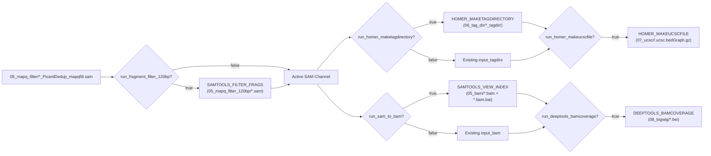
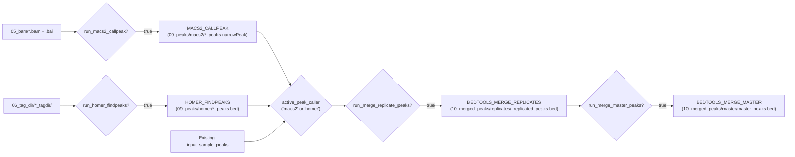
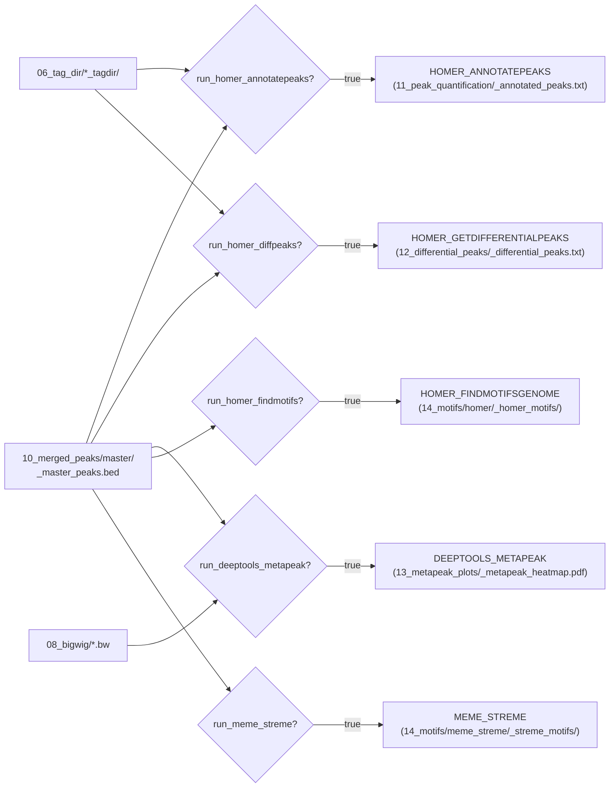

# CUT&RUN Downstream Analysis — User's Guide

This guide covers how to configure, preview, and execute the CUT&RUN downstream analysis pipeline from the `Analysis_Run/` workspace.

---

## 1. Prerequisites & Environment

1. **Nextflow (`>=25.10.4`):** Installed and available on your `PATH`.
2. **Container Engine (Docker Recommended):** Docker Desktop (or Singularity/Apptainer/Conda via Nextflow `-profile`) must be running. The pipeline automatically mounts both the project repository and your `params.input_dir` into the containers.
3. **Dropbox Offline Availability:** If reading input files from a Dropbox folder (e.g., `<dropbox_dir>/Bioinformatics_parent/cut_run103026`), ensure the required input subfolders (`05_mapq_filter/`, `06_index_bam/`, `07_ucsc/`, `08_bigwig/`) are set to **"Make available offline"** in Finder. The pipeline automatically warns and skips any `0B` online-only placeholder files.

---

## 2. Workspace Architecture

All pipeline runs are launched from [`Analysis_Run/`](../Analysis_Run) so that intermediate Nextflow `work/` directories and published `results/` remain on your local hard drive outside of Dropbox sync:

```text
Cut_And_Run_Analysis/
├── Makefile                             # Root task shortcuts (make lint, make dry-run, make run)
├── main.nf                              # Pipeline entrypoint
├── nextflow.config                      # Global defaults & container profiles
└── Analysis_Run/                        # Execution workspace (launchDir)
    ├── run.sh                           # Wrapper script to launch Nextflow
    ├── config/
    │   ├── experiment.config            # Step toggles (run_*) and tool parameters
    │   └── samplesheet.csv              # Sample-to-condition and replicate mapping
    ├── work/                            # Local Nextflow task scratch directory (auto-created)
    └── results/
        └── <experiment>/                # Published outputs organized by numbered step
```

---

## 3. Configuring Sample Metadata (`samplesheet.csv`)

Edit [`Analysis_Run/config/samplesheet.csv`](../Analysis_Run/config/samplesheet.csv) to map each `sample_id` (matching the prefix before `_PicardDedup_mapqfilt.sam`, `.bw`, or `.ucsc.bedGraph.gz`) to its biological `sample_name`, `condition`, `target` (histone mark or TF), `replicate`, and optional `control_id` (IgG):

```csv
sample_id,sample_name,condition,target,replicate,control_id
L9254-0001-0001_S141_L004,EV_INT_H3K4me3,EV_INT_H3K4me3,H3K4me3,1,L9254-0001-0003_S143_L004
L9254-0001-0002_S142_L004,EV_INT_H3K27me3,EV_INT_H3K27me3,H3K27me3,1,L9254-0001-0003_S143_L004
L9254-0001-0003_S143_L004,EV_INT_IgG,EV_INT_IgG,IgG,1,
L9254-0001-0004_S66_L008,N2_H3K4me3,N2_H3K4me3,H3K4me3,1,
L9254-0001-0005_S67_L008,N2_H3K27me3,N2_H3K27me3,H3K27me3,1,
L9254-0001-0006_S68_L008,EV_INT_MC_H3K4me3,EV_INT_MC_H3K4me3,H3K4me3,1,L9254-0001-0003_S143_L004
```

> [!NOTE]
> - Samples with `target == 'IgG'` automatically receive HOMER tag directories and browser tracks (Steps `a` and `b`), but are excluded from target peak calling and master peak merging (Steps `c` and `d`).
> - Master peaks are merged separately per `target` (`H3K4me3_master_peaks.bed` and `H3K27me3_master_peaks.bed`).

---

## 4. Phase 2 Steps: Core Preparation & Genome Browser Tracks

Each step in Phase 2 is controlled by boolean toggles (`true` / `false`) in [`Analysis_Run/config/experiment.config`](../Analysis_Run/config/experiment.config). When a step's toggle is set to `false`, downstream steps automatically fall back to pre-existing files defined by the `input_*` globs.



---

### Pre-Step (Optional): Filtering for Fragments $\le 120\text{ bp}$ (TFs Only)
- **Module:** `SAMTOOLS_FILTER_FRAGS` (`modules/local/samtools_filter_frags/main.nf`)
- **Purpose:** Filters deduplicated, MAPQ-filtered SAM files to retain only paired-end fragments with insert length $\le 120\text{ bp}$ (`$9 <= 120 && $9 >= 1 || $9 >= -120 && $9 <= -1`) while preserving the SAM header. Recommended for narrow transcription factor (TF) CUT&RUN datasets.
- **Configuration in `experiment.config`:**
  ```groovy
  run_fragment_filter_120bp = true   // Set to false for histone marks or unfiltered reads
  input_sam                 = "${params.input_dir}/05_mapq_filter/*_PicardDedup_mapqfilt.sam"
  ```
- **Underlying Command:**
  ```bash
  samtools view -h <sample>.sam | \
      awk '/^@/ || ($9 <= 120 && $9 >= 1) || ($9 >= -120 && $9 <= -1)' > <sample>_1_120.sam
  ```
- **Published Output:** `Analysis_Run/results/<experiment>/05_mapq_filter_120bp/<sample_id>_1_120.sam`

---

### Step `a`: Making a HOMER Tag Directory
- **Module:** `HOMER_MAKETAGDIRECTORY` (`modules/local/homer_maketagdirectory/main.nf`)
- **Purpose:** Creates a HOMER tag directory for each sample from the active SAM alignment channel (either the raw `05_mapq_filter/*.sam` or the $\le 120\text{ bp}$ filtered SAM if `run_fragment_filter_120bp = true`). Required for HOMER browser track generation, HOMER peak calling, peak annotation, and differential peak analysis.
- **Configuration in `experiment.config`:**
  ```groovy
  run_homer_maketagdirectory = true
  // Used only when run_homer_maketagdirectory = false:
  input_tagdirs              = "${params.outdir}/06_tag_dir/*_tagdir"
  ```
- **Underlying Command:**
  ```bash
  makeTagDirectory <sample_id>_tagdir/ <sample>.sam
  ```
- **Published Output:** `Analysis_Run/results/<experiment>/06_tag_dir/<sample_id>_tagdir/`

---

### Step `b` (Part 1): Making UCSC `bedGraph` Browser Tracks with HOMER
- **Module:** `HOMER_MAKEUCSCFILE` (`modules/local/homer_makeucscfile/main.nf`)
- **Purpose:** Generates gzipped UCSC `bedGraph` tracks from each sample's HOMER tag directory.
- **Configuration in `experiment.config`:**
  ```groovy
  run_homer_makeucscfile = true   // Set to false if 07_ucsc/*.ucsc.bedGraph.gz already exist
  // Used when run_homer_makeucscfile = false:
  input_ucsc_bedgraph    = "${params.input_dir}/07_ucsc/**/*.ucsc.bedGraph.gz"
  ```
- **Underlying Command:**
  ```bash
  makeUCSCfile <sample_id>_tagdir/ -o auto
  cp <sample_id>_tagdir/*.ucsc.bedGraph.gz <sample_id>.ucsc.bedGraph.gz
  ```
- **Published Output:** `Analysis_Run/results/<experiment>/07_ucsc/<sample_id>/<sample_id>.ucsc.bedGraph.gz`

---

### Step `b` (Part 2): Converting SAM to Indexed BAM with `samtools`
- **Module:** `SAMTOOLS_VIEW_INDEX` (`modules/local/samtools_view_index/main.nf`)
- **Purpose:** Converts the coordinate-sorted SAM file into binary `.bam` format and creates its `.bam.bai` index. Required for `deepTools bamCoverage` and `MACS2 callpeak`.
- **Configuration in `experiment.config`:**
  ```groovy
  run_sam_to_bam = true   // Set to false if indexed BAMs already exist in input_bam
  // Used when run_sam_to_bam = false:
  input_bam      = "${params.outdir}/05_bam/*.bam"
  ```
- **Underlying Command:**
  ```bash
  samtools view -@ <cpus> -bh <sample>.sam > <sample_id>.bam
  samtools index -@ <cpus> <sample_id>.bam
  ```
- **Published Output:**
  - `Analysis_Run/results/<experiment>/05_bam/<sample_id>.bam`
  - `Analysis_Run/results/<experiment>/05_bam/<sample_id>.bam.bai`

---

### Step `b` (Part 3): Making `bigWig` Browser Tracks with `deepTools`
- **Module:** `DEEPTOOLS_BAMCOVERAGE` (`modules/local/deeptools_bamcoverage/main.nf`)
- **Purpose:** Generates normalized `.bw` (`bigWig`) coverage tracks from indexed BAM files using `deepTools bamCoverage`.
- **Configuration in `experiment.config`:**
  ```groovy
  run_deeptools_bamcoverage = false  // Set to true to generate new .bw files, or false to reuse input_bigwig
  bamcoverage_norm          = "RPKM" // Normalization method (--normalizeUsing)
  // Used when run_deeptools_bamcoverage = false:
  input_bigwig              = "${params.input_dir}/08_bigwig/*.bw"
  ```
- **Underlying Command:**
  ```bash
  bamCoverage -b <sample_id>.bam --normalizeUsing RPKM -p <cpus> -o <sample_id>.bw
  ```
- **Published Output:** `Analysis_Run/results/<experiment>/08_bigwig/<sample_id>.bw`

---

## 5. Phase 3 Steps: Peak Calling & Replicate / Master Peak Merging

Phase 3 implements Steps `c` and `d` from [`docs/Downstream_analysis_steps.md`](Downstream_analysis_steps.md): calling peaks per sample with MACS2 and/or HOMER, filtering peaks across replicates within each biological condition, and merging condition peaks into an inclusive `master_peaks.bed`.



---

### Step `c` (Option 1): Calling Peaks with MACS2
- **Module:** [`MACS2_CALLPEAK`](../nf-cutandrun/modules/local/macs2_callpeak/main.nf)
- **Purpose:** Calls narrow (or broad) peaks per sample from indexed paired-end BAM files (`-f BAMPE`) without a background IgG control file by default.
- **Configuration in `experiment.config`:**
  ```groovy
  run_macs2_callpeak = true
  macs2_gsize        = "ce"      // Genome size shortcut: 'hs', 'mm', 'ce', 'dm', or numeric bp
  macs2_format       = "BAMPE"   // Paired-end BAM mode
  macs2_qvalue       = 0.01      // Minimum FDR (q-value) cutoff
  macs2_broad        = false     // Set true to append --broad --broad-cutoff
  macs2_broad_cutoff = 0.1
  ```
- **Underlying Command:**
  ```bash
  macs2 callpeak \
      -t <sample_id>.bam \
      -n <sample_id> \
      -g ce -f BAMPE -q 0.01
  ```
- **Published Outputs (`Analysis_Run/results/<experiment>/09_peaks/macs2/`):**
  - `<sample_id>_peaks.narrowPeak` (or `<sample_id>_peaks.broadPeak` when `macs2_broad = true`)
  - `<sample_id>_peaks.xls`
  - `<sample_id>_summits.bed` (or `<sample_id>_peaks.gappedPeak` when `macs2_broad = true`)

---

### Step `c` (Option 2): Calling Peaks with HOMER
- **Module:** [`HOMER_FINDPEAKS`](../nf-cutandrun/modules/local/homer_findpeaks/main.nf)
- **Purpose:** Calls narrower transcription factor (`-style factor`) or broader histone (`-style histone`) peaks from each sample's HOMER tag directory using `findPeaks`, and converts the output to standard 6-column BED format via `pos2bed.pl`.
- **Configuration in `experiment.config`:**
  ```groovy
  run_homer_findpeaks = true
  homer_peak_style    = "factor" // 'factor' (narrow TF) or 'histone' (broad histone mark)
  ```
- **Underlying Command:**
  ```bash
  findPeaks <sample_id>_tagdir/ -style factor -o <sample_id>_peaks.txt
  pos2bed.pl <sample_id>_peaks.txt > <sample_id>_peaks.bed
  ```
- **Published Outputs (`Analysis_Run/results/<experiment>/09_peaks/homer/`):**
  - `<sample_id>_peaks.txt`
  - `<sample_id>_peaks.bed`

> [!TIP]
> You can enable **both** `run_macs2_callpeak = true` and `run_homer_findpeaks = true` in the same run to compare their peak calls side-by-side in the genome browser. Use `active_peak_caller = "macs2"` (or `"homer"`) to choose which caller feeds into Step `d` (Peak Merging).

---

### Step `d` (Part 1): Merging Replicate Peaks per Condition (`bedtools`)
- **Module:** [`BEDTOOLS_MERGE_REPLICATES`](../nf-cutandrun/modules/local/bedtools_merge_replicates/main.nf)
- **Purpose:** Groups sample peak files by `condition` (from [`Analysis_Run/config/samplesheet.csv`](../Analysis_Run/config/samplesheet.csv)), sorts and merges overlapping intervals using `bedtools`, and retains only peaks called in at least `min_replicate_overlap` replicates (default `2`) to filter out noisy single-replicate blips.
- **Configuration in `experiment.config`:**
  ```groovy
  run_merge_replicate_peaks = true
  active_peak_caller        = "macs2" // 'macs2' or 'homer'
  min_replicate_overlap     = 2       // Keep peaks called in >= 2 replicates of the same condition
  // Used if both peak callers are false:
  input_sample_peaks        = "${params.outdir}/09_peaks/${params.active_peak_caller}/*_peaks.{narrowPeak,broadPeak,bed}"
  ```
- **Underlying Command:**
  ```bash
  awk 'BEGIN{OFS="\t"} !/^#/ && !/^track/ && !/^browser/ && NF>=3 {print $1, $2, $3, FILENAME}' <rep1.bed> <rep2.bed> <rep3.bed> > combined_unmerged.bed
  bedtools sort -i combined_unmerged.bed | \
      bedtools merge -i stdin -c 4 -o count_distinct | \
      awk -v min_rep=2 'BEGIN{OFS="\t"} $4 >= min_rep {print $1, $2, $3}' > <condition>_replicated_peaks.bed
  ```
- **Published Output:** `Analysis_Run/results/<experiment>/10_merged_peaks/replicates/<condition>_replicated_peaks.bed`

---

### Step `d` (Part 2): Creating an Inclusive Master Peak Set per Target/Histone Mark (`bedtools`)
- **Module:** [`BEDTOOLS_MERGE_MASTER`](../nf-cutandrun/modules/local/bedtools_merge_master/main.nf)
- **Purpose:** Groups the replicated peak BED files by `target` (e.g., `H3K4me3` across `EV_INT_H3K4me3`, `N2_H3K4me3`, `EV_INT_MC_H3K4me3`; and `H3K27me3` across `EV_INT_H3K27me3`, `N2_H3K27me3`), sorts by genomic coordinate, and inclusively merges overlapping intervals into `<target>_master_peaks.bed` (`H3K4me3_master_peaks.bed` and `H3K27me3_master_peaks.bed`).
- **Configuration in `experiment.config`:**
  ```groovy
  run_merge_master_peaks = true
  // Used when run_merge_master_peaks = false:
  input_peaks_bed        = "${params.outdir}/10_merged_peaks/master/*_master_peaks.bed"
  ```
- **Underlying Command:**
  ```bash
  awk 'BEGIN{OFS="\t"} !/^#/ && !/^track/ && !/^browser/ && NF>=3 {print $1, $2, $3}' <cond1_replicated_peaks.bed> <cond2_replicated_peaks.bed> > combined_conditions.bed
  bedtools sort -i combined_conditions.bed | \
      bedtools merge -i stdin > <target>_master_peaks.bed
  ```
- **Published Output:** `Analysis_Run/results/<experiment>/10_merged_peaks/master/<target>_master_peaks.bed`

---

## 6. Phase 4 Steps: Quantification, Differential Analysis, Visualization & Motifs

Phase 4 implements Steps `e`, `f`, `g`, and `h` from [`docs/Downstream_analysis_steps.md`](Downstream_analysis_steps.md). Because master peaks are grouped by `target` (`H3K4me3_master_peaks.bed` and `H3K27me3_master_peaks.bed`), each downstream analysis automatically runs per histone mark/target using the matching sample tag directories and BigWig tracks.



---

### Step `e`: Peak-by-Peak Quantification & Annotation (`annotatePeaks.pl`)
- **Module:** [`HOMER_ANNOTATEPEAKS`](../nf-cutandrun/modules/local/homer_annotatepeaks/main.nf)
- **Purpose:** Quantifies normalized tag counts (fragments per 10 million mapped) across all samples for a given `target` at each interval in `<target>_master_peaks.bed`, while annotating nearest TSS, gene IDs, and genomic features.
- **Configuration in `experiment.config`:**
  ```groovy
  run_homer_annotatepeaks = true
  genome_name             = "ce11"    // Reference genome name for HOMER (e.g., ce11, mm10, hg38, dm6)
  annotatepeaks_size      = "given"   // Quantify reads across the exact width of each called peak
  ```
- **Underlying Command:**
  ```bash
  annotatePeaks.pl <target>_master_peaks.bed \
      ce11 \
      -size given \
      -cpu <cpus> \
      -d <sample1_tagdir/> <sample2_tagdir/> ... \
      > <target>_annotated_peaks.txt
  ```
- **Published Output:** `Analysis_Run/results/<experiment>/11_peak_quantification/<target>_annotated_peaks.txt`
- **Width-Normalized Tag Helper (`nf-cutandrun/bin/normalize_homer_peaks.py`):**
  Since HOMER does not normalize tag counts by peak width when `-size given` is used, you can optionally run the included helper script [`nf-cutandrun/bin/normalize_homer_peaks.py`](../nf-cutandrun/bin/normalize_homer_peaks.py) to append `*_per_kb` columns to any `annotatePeaks` output table:
  ```bash
  uv run python3 nf-cutandrun/bin/normalize_homer_peaks.py \
      Analysis_Run/results/cut_run103026/11_peak_quantification/H3K4me3_annotated_peaks.txt \
      Analysis_Run/results/cut_run103026/11_peak_quantification/H3K4me3_annotated_peaks_per_kb.txt
  ```

---

### Step `f`: Calling Differential Peaks (`getDifferentialPeaksReplicates.pl`)
- **Module:** [`HOMER_GETDIFFERENTIALPEAKS`](../nf-cutandrun/modules/local/homer_getdifferentialpeaks/main.nf)
- **Purpose:** Tests statistical significance (DESeq2/edgeR adjusted p-value / FDR) of fold changes between treatment (`-t`) and background/control (`-b`) conditions across `<target>_master_peaks.bed`.
- **Configuration in `experiment.config`:**
  ```groovy
  run_homer_diffpeaks = true
  diff_contrasts      = [
      [ id: 'EV_INT_vs_N2_H3K4me3',    treatment: 'EV_INT_H3K4me3',    background: 'N2_H3K4me3',  target: 'H3K4me3' ],
      [ id: 'EV_INT_MC_vs_N2_H3K4me3', treatment: 'EV_INT_MC_H3K4me3', background: 'N2_H3K4me3',  target: 'H3K4me3' ],
      [ id: 'EV_INT_vs_N2_H3K27me3',   treatment: 'EV_INT_H3K27me3',   background: 'N2_H3K27me3', target: 'H3K27me3' ]
  ]
  ```
- **Underlying Command:**
  ```bash
  getDifferentialPeaksReplicates.pl \
      -t <treatment_rep1_tagdir/> <treatment_rep2_tagdir/> \
      -b <background_rep1_tagdir/> <background_rep2_tagdir/> \
      -p <target>_master_peaks.bed \
      -genome ce11 \
      -all > <contrast_id>_differential_peaks.txt
  ```
- **Published Output:** `Analysis_Run/results/<experiment>/12_differential_peaks/<contrast_id>_differential_peaks.txt`

---

### Step `g`: Making Metapeak / Tornado Plots (`deepTools`)
- **Module:** [`DEEPTOOLS_METAPEAK`](../nf-cutandrun/modules/local/deeptools_metapeak/main.nf)
- **Purpose:** Computes signal matrices (`computeMatrix reference-point`) centered on `<target>_master_peaks.bed` across all BigWig tracks for that target (`08_bigwig/*.bw`) and renders tornado heatmaps (`plotHeatmap`).
- **Configuration in `experiment.config`:**
  ```groovy
  run_deeptools_metapeak   = true
  metapeak_upstream        = 2000      // -b BP_UPSTREAM
  metapeak_downstream      = 2000      // -a BP_DOWNSTREAM
  metapeak_reference_point = "center"  // --referencePoint center
  heatmap_colormap         = "inferno" // --colorMap inferno
  heatmap_interpolation    = "nearest" // --interpolationMethod nearest
  ```
- **Underlying Command:**
  ```bash
  computeMatrix reference-point \
      -S <sample1.bw> <sample2.bw> ... \
      -R <target>_master_peaks.bed \
      -a 2000 -b 2000 \
      --referencePoint center \
      -p <cpus> \
      -o <target>_matrix.mat.gz

  plotHeatmap \
      -m <target>_matrix.mat.gz \
      --colorMap inferno \
      --interpolationMethod nearest \
      -o <target>_metapeak_heatmap.pdf
  ```
- **Published Outputs (`Analysis_Run/results/<experiment>/13_metapeak_plots/`):**
  - `<target>_matrix.mat.gz`
  - `<target>_metapeak_heatmap.pdf`

---

### Step `h` (Option 1): Enriched Motif Discovery with HOMER (`findMotifsGenome.pl`)
- **Module:** [`HOMER_FINDMOTIFSGENOME`](../nf-cutandrun/modules/local/homer_findmotifsgenome/main.nf)
- **Purpose:** Searches for known and *de novo* enriched sequence motifs within `<target>_master_peaks.bed`.
- **Configuration in `experiment.config`:**
  ```groovy
  run_homer_findmotifs = true
  homer_motif_size     = "100"   // Region size centered on peak center (e.g., "100" or "given")
  ```
- **Underlying Command:**
  ```bash
  findMotifsGenome.pl <target>_master_peaks.bed \
      ce11 \
      <target>_homer_motifs/ \
      -size 100 \
      -p <cpus>
  ```
- **Published Output:** `Analysis_Run/results/<experiment>/14_motifs/homer/<target>_homer_motifs/` (contains `knownResults.html` and `homerResults.html`).

---

### Step `h` (Option 2): Enriched Motif Discovery with MEME Suite (`STREME`)
- **Module:** [`MEME_STREME`](../nf-cutandrun/modules/local/meme_streme/main.nf)
- **Purpose:** Finds peak centers via `awk`, expands $\pm 50\text{ bp}$ (`100 bp` windows) with `bedtools slop`, extracts sequences with `bed2fasta`, and runs *de novo* motif discovery using `streme`.
- **Configuration in `experiment.config`:**
  ```groovy
  run_meme_streme     = false
  genome_fasta        = "${projectDir}/assets/GENOME.fa"                           // Required when run_meme_streme = true
  chrom_sizes         = "${projectDir}/assets/homer_ce11/data/genomes/ce11/chrom.sizes" // Required when run_meme_streme = true
  meme_slop_left      = 50
  meme_slop_right     = 49
  meme_streme_nmotifs = 20
  ```
- **Underlying Command:**
  ```bash
  awk 'BEGIN{FS=OFS="\t"} !/^#/ && !/^track/ && !/^browser/ && NF>=3 {print $1, int(($2 + $3)/2), int(($2 + $3)/2) + 1}' <target>_master_peaks.bed | \
      bedtools slop -i stdin -g GENOME.chrom.sizes -l 50 -r 49 > <target>_centers_PlusMinus50bp.bed
  bed2fasta -o <target>_centers_PlusMinus50bp.fa <target>_centers_PlusMinus50bp.bed GENOME.fa
  streme --oc <target>_streme_motifs --nmotifs 20 --dna --p <target>_centers_PlusMinus50bp.fa
  ```
- **Published Outputs (`Analysis_Run/results/<experiment>/14_motifs/meme_streme/`):**
  - `<target>_centers_PlusMinus50bp.bed`
  - `<target>_centers_PlusMinus50bp.fa`
  - `<target>_streme_motifs/` (`streme.html`, `streme.txt`)

---

## 7. How to Run the Pipeline

### Option A: Using `make` from the Project Root (Recommended)

From the project root directory (`Cut_And_Run_Analysis/`):

1. **Validate configuration syntax:**
   ```bash
   make lint
   ```
2. **Dry-run preview (verifies which processes and channels will run without executing containers):**
   ```bash
   make dry-run
   ```
3. **Execute the pipeline:**
   ```bash
   make run
   ```
4. **Clean transient work directories and logs:**
   ```bash
   make clean
   ```

### Option B: Running Directly from `Analysis_Run/`

From `Analysis_Run/`:

1. **Using the wrapper script (`run.sh`):**
   ```bash
   ./run.sh
   ```
   Any extra flags passed to `./run.sh` are forwarded directly to `nextflow run`:
   ```bash
   # Run a fast stub test to verify channel flow and output directory structure:
   ./run.sh -stub-run

   # Override a specific toggle on the command line for a one-off run:
   ./run.sh --run_deeptools_bamcoverage true --run_homer_makeucscfile true
   ```

2. **Running `nextflow` directly:**
   ```bash
   nextflow -c config/experiment.config run ../ -resume
   ```

---

## 8. Common Recipes

### Recipe 1: Generate Only HOMER Tag Directories & Indexed BAMs (Default for `cut_run103026`)
Since `07_ucsc/` and `08_bigwig/` already exist in Dropbox for `cut_run103026`, the default `experiment.config` skips regenerating `bedGraph` and `bigWig` tracks and only builds the HOMER tag directories and indexed BAMs needed for peak calling:
```groovy
run_fragment_filter_120bp  = false
run_homer_maketagdirectory = true
run_homer_makeucscfile     = false
run_sam_to_bam             = true
run_deeptools_bamcoverage  = false
```

### Recipe 2: Re-compute Everything from $\le 120\text{ bp}$ Filtered TF Fragments
If analyzing a transcription factor where you want all browser tracks and tag directories restricted to $\le 120\text{ bp}$ nucleosome-free fragments:
```groovy
run_fragment_filter_120bp  = true
run_homer_maketagdirectory = true
run_homer_makeucscfile     = true
run_sam_to_bam             = true
run_deeptools_bamcoverage  = true
```

### Recipe 3: Reuse Already-Created Tag Directories & BAMs
Once `06_tag_dir/` and `05_bam/` have been generated in `Analysis_Run/results/cut_run103026/`, you can either rely on Nextflow's `-resume` cache or explicitly toggle them off so future runs start immediately at Step `c` (Peak Calling):
```groovy
run_fragment_filter_120bp  = false
run_homer_maketagdirectory = false
run_homer_makeucscfile     = false
run_sam_to_bam             = false
run_deeptools_bamcoverage  = false
```

### Recipe 4: Call Broad Peaks with MACS2 or Switch to HOMER `findPeaks`
If narrow MACS2 peaks look too fragmented (e.g., for histone modifications or broad chromatin factors), switch to MACS2 `--broad` mode or HOMER `findPeaks`:
```groovy
// Option A: MACS2 broad peaks
run_macs2_callpeak        = true
macs2_broad               = true
active_peak_caller        = "macs2"

// Option B: HOMER findPeaks (factor or histone style)
run_macs2_callpeak        = false
run_homer_findpeaks       = true
homer_peak_style          = "histone"   // or "factor"
active_peak_caller        = "homer"
```

### Recipe 5: Re-run Only Tornado Plots (`deepTools`) & Quantification on Existing Master Peaks
If you already generated `H3K4me3_master_peaks.bed` and `H3K27me3_master_peaks.bed` in `10_merged_peaks/master/` and just want to tweak `metapeak_upstream` / `heatmap_colormap` or re-run `annotatePeaks.pl`:
```groovy
run_homer_maketagdirectory = false
run_sam_to_bam             = false
run_macs2_callpeak         = false
run_merge_replicate_peaks  = false
run_merge_master_peaks     = false
run_homer_annotatepeaks    = true
run_deeptools_metapeak     = true
run_homer_findmotifs       = false
```

---

## 9. Execution Reports & Logs

Every run automatically writes execution diagnostics to `Analysis_Run/results/<experiment>/pipeline_info/`:
- `execution_report_<timestamp>.html`: Resource usage (CPU, RAM, runtime) per task.
- `execution_timeline_<timestamp>.html`: Visual Gantt chart of task execution across samples.
- `execution_trace_<timestamp>.txt`: Tab-separated task trace table.
- `pipeline_dag_<timestamp>.html`: Interactive workflow DAG diagram.
- `software_mqc_versions.yml`: Collated versions of `samtools`, `homer`, and `deeptools` executed in the run.

