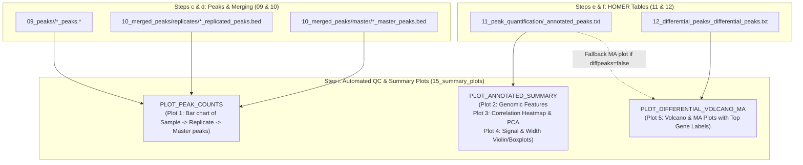

# Implementation Plan: Automated QC & Summary Plots (`15_summary_plots/`)

## 1. Objective & Scope

Extend the `nf-cutandrun` Nextflow pipeline with **Step i: Automated QC & Summary Plots (`15_summary_plots/`)**, implementing all five candidate visualizations from Section 6 of [`docs/TUTORIAL_FOR_NON_SCIENTISTS.md`](docs/TUTORIAL_FOR_NON_SCIENTISTS.md#L281-L297):

1. **Plot 1 — Peak Count & Replicate Overlap Bar Chart (`09_peaks` & `10_merged_peaks`):**
   - Grouped/layered bar chart per target showing per-sample called peak counts (MACS2 and/or HOMER), condition-level replicate-filtered peak counts (`10_merged_peaks/replicates/`), and final target-level master peak counts (`10_merged_peaks/master/`), plus a companion summary TSV table.
2. **Plot 2 — Genomic Feature Breakdown Stacked Bar & Donut Charts (`11_peak_quantification`):**
   - Parses the HOMER `Annotation` column (`promoter-TSS`, `exon`, `intron`, `TTS`, `5' UTR`, `3' UTR`, `non-coding`, `Intergenic`) per target, rendering both a per-target donut/pie breakdown and a cross-target 100% stacked horizontal bar chart, plus a companion summary TSV table.
3. **Plot 3 — Sample Correlation Heatmap & PCA Plot (`11_peak_quantification`):**
   - Extracts normalized tag count columns across all samples per target, applies $\log_2(\text{Tag Count} + 1)$ transformation, and renders:
     - **Pearson & Spearman Sample Correlation Heatmap** with hierarchical clustering dendrograms (`scipy.cluster.hierarchy`) and numeric correlation annotations.
     - **2D Principal Component Analysis (PCA) Scatter Plot** (via `numpy.linalg.svd`) with `% variance explained` on PC1/PC2 axes, colored by condition and labeled with human-readable `sample_name` from `samplesheet.csv`.
4. **Plot 4 — Signal Distribution & Peak Width Violin/Box Plots (`11_peak_quantification`):**
   - Multi-panel violin + boxplot figure per target comparing:
     - Raw normalized signal distribution: $\log_2(\text{Tag Count} + 1)$ across samples/conditions.
     - Width-normalized signal density: $\log_2(\text{Tags per kb} + 1)$ where $\text{Tags per kb} = \frac{\text{Tag Count}}{(\text{End} - \text{Start}) / 1000}$.
     - Master peak width distribution ($\text{bp}$ and $\log_{10}\text{bp}$) with median/IQR callouts.
5. **Plot 5 — Volcano & MA Plots for Condition Comparisons (`12_differential_peaks` & `11_peak_quantification`):**
   - For each contrast in `params.diff_contrasts`:
     - **Volcano Plot:** $\log_2(\text{Fold Change})$ vs. $-\log_{10}(\text{FDR / adj. p-value})$ from `12_differential_peaks/<contrast>_differential_peaks.txt`, highlighting Up-regulated ($\text{FDR} < 0.05, \log_2\text{FC} \ge 1$), Down-regulated ($\text{FDR} < 0.05, \log_2\text{FC} \le -1$), and Non-significant peaks, with non-overlapping text callouts for the top $N$ genes (`Gene Name`).
     - **MA Plot (Bland-Altman):** Mean signal intensity $\frac{1}{2}\log_2((\text{Treat}+1)(\text{Bg}+1))$ vs. $\log_2(\text{Fold Change})$, functioning both when `12_differential_peaks` is available (coloring by FDR significance) and as a fallback directly from `11_peak_quantification` when `run_homer_diffpeaks = false` (highlighting $|\log_2\text{FC}| \ge 1$).

---

## 2. Architectural Design & Container Strategy

### 2.1 Zero-Download Container Reuse
- All plotting modules will reuse the already-cached container image from `DEEPTOOLS_METAPEAK`:
  `community.wave.seqera.io/library/deeptools:3.5.6--511a2b05870b9ec3`
- Verified pre-installed stack inside this container:
  - `Python 3.13.16`
  - `numpy 2.5.4`
  - `scipy 1.18.1`
  - `matplotlib 3.11.2`
- No external internet pulls or new Docker builds are required. Both high-resolution vector **`.pdf`** (for publication) and **`.png`** (300 DPI, for quick viewing/reports) outputs are emitted alongside tidy **`.tsv`** summary tables.

### 2.2 Dual Input Resolution (Compute or Reuse)
Consistent with Steps `c`–`h`, Step `i` (`run_summary_plots = true`) will support:
1. **In-Memory Channel Mode:** Automatically consumes outputs emitted by `MACS2_CALLPEAK`, `HOMER_FINDPEAKS`, `BEDTOOLS_MERGE_REPLICATES`, `BEDTOOLS_MERGE_MASTER`, `HOMER_ANNOTATEPEAKS`, and `HOMER_GETDIFFERENTIALPEAKS` during a full run.
2. **Standalone / Pre-Existing Results Mode:** When upstream `run_*` toggles are set to `false` (so a user can re-generate plots in seconds without re-running peak calling or HOMER), `main.nf` resolves existing files from:
   - `params.input_sample_peaks` (`09_peaks/${params.active_peak_caller}/*`)
   - `params.input_replicated_peaks` (`10_merged_peaks/replicates/*_replicated_peaks.bed`)
   - `params.input_peaks_bed` (`10_merged_peaks/master/*_master_peaks.bed`)
   - `params.input_annotated_peaks` (`11_peak_quantification/*_annotated_peaks.txt`)
   - `params.input_diff_peaks` (`12_differential_peaks/*_differential_peaks.txt`)

### 2.3 Updated Pipeline DAG



---

## 3. SOLID Python Package Architecture (`nf-cutandrun/bin/`)

Following the project's SOLID & Python 3.12+ strict typing directives, plotting logic is split into clean, single-responsibility scripts placed in `nf-cutandrun/bin/` (automatically added to `$PATH` by Nextflow):

### 3.1 Shared Domain & Parsing Layer (`nf-cutandrun/bin/cutandrun_plot_utils.py`)
- **Data Contracts (`dataclasses` with strict type hints):**
  - `SampleMetadata`: Maps `sample_id` $\rightarrow$ `sample_name`, `condition`, `target`, `replicate` from `samplesheet.csv`.
  - `HomerPeakTable`: Strongly-typed representation of `annotatePeaks.pl` and `getDifferentialPeaksReplicates.pl` tables:
    - Extracts coordinates (`Chr`, `Start`, `End`, computed `width_bp` and `width_kb`).
    - Normalizes raw HOMER `Annotation` strings (e.g., `promoter-TSS (NM_060973)` $\rightarrow$ `Promoter-TSS`, `exon (...)` $\rightarrow$ `Exon`, `intron (...)` $\rightarrow$ `Intron`, `TTS (...)` $\rightarrow$ `TTS`, `Intergenic` $\rightarrow$ `Intergenic`).
    - Parses dynamic sample tag count headers (`<sample_id> Tag Count in given bp ...`) and maps `<sample_id>` to human-readable `sample_name` via `samplesheet.csv`.
    - Computes width-normalized signal ($\text{Tags per kb}$) and $\log_2(\text{value} + 1)$ matrices.
- **Publication Styling Helper:** Consistent colorblind-safe palette (Okabe-Ito / Viridis), clean despun axes, typography, and dual `.pdf` + `.png` (300 DPI) figure export.

### 3.2 Script 1: `nf-cutandrun/bin/plot_peak_counts.py` (Plot 1)
- **Inputs:** `--samplesheet`, `--sample-peaks` (list of BED/narrowPeak/broadPeak files), `--replicated-peaks` (list of BED files), `--master-peaks` (list of BED files), `--out-prefix`.
- **Logic:**
  - Counts lines (non-header/non-comment intervals) in each BED/peak file.
  - Groups by `target` (e.g., `H3K4me3`, `H3K27me3`).
  - Produces a multi-panel or grouped horizontal/vertical bar chart per target showing:
    1. Individual sample peak counts (colored by condition, with exact count labels above bars).
    2. Replicate-merged peak counts per condition (`min_replicate_overlap` threshold).
    3. Final merged master peak count for that target.
- **Outputs:**
  - `15_summary_plots/01_peak_counts/peak_counts_summary.pdf` & `.png`
  - `15_summary_plots/01_peak_counts/peak_counts_summary.tsv`

### 3.3 Script 2: `nf-cutandrun/bin/plot_annotated_features_qc.py` (Plots 2, 3, & 4)
Operates per target on `<target>_annotated_peaks.txt` + `samplesheet.csv` (and emits target-specific figures plus a combined cross-target summary):
- **Plot 2 — Genomic Feature Breakdown (`<target>_genomic_features.pdf/.png` & `.tsv`):**
  - Left panel: Horizontal bar chart of peak counts & percentages across genomic categories (`Promoter-TSS`, `Exon`, `Intron`, `TTS`, `5' UTR`, `3' UTR`, `Non-coding`, `Intergenic`).
  - Right panel: Clean donut chart with percentage callouts and total master peak count in the center, plus a distance-to-TSS histogram inset/panel (`-5 kb` to `+5 kb`).
- **Plot 3 — Sample Correlation Heatmap & PCA (`<target>_correlation_pca.pdf/.png` & `.tsv`):**
  - Left panel: Clustered Pearson (and Spearman) correlation matrix on $\log_2(\text{Tag Count} + 1)$ across samples, with hierarchical dendrogram and in-cell $r$ values.
  - Right panel: 2D PCA scatter plot (`PC1` vs `PC2` with `% variance explained` on axes), points colored by condition and annotated with `sample_name`. Gracefully handles $N \ge 2$ samples.
- **Plot 4 — Signal Distribution & Peak Width Box/Violin Plots (`<target>_signal_and_width_distributions.pdf/.png` & `.tsv`):**
  - Panel A: Violin + boxplot of $\log_2(\text{Tag Count} + 1)$ per sample (mapped to `sample_name` and colored by `condition`).
  - Panel B: Violin + boxplot of length-normalized $\log_2(\text{Tags per kb} + 1)$ per sample.
  - Panel C: Peak width distribution ($\log_{10}\text{bp}$) with median and interquartile range annotations.

### 3.4 Script 3: `nf-cutandrun/bin/plot_differential_volcano_ma.py` (Plot 5)
Operates per contrast on `<contrast>_differential_peaks.txt` (from `12_differential_peaks/`):
- **Inputs:** `--diff-file`, `--contrast-id`, `--treatment`, `--background`, `--target`, `--fdr-threshold` (default `0.05`), `--log2fc-threshold` (default `1.0`), `--top-n-labels` (default `15`).
- **Note on Sign Convention:** HOMER's `getDifferentialPeaksReplicates.pl` outputs column `bg vs. target Log2 Fold Change` where positive values mean higher in `target` (treatment) relative to `bg` (background). The script verifies header labels and clearly annotates arrows: $\text{Higher in } \texttt{treatment} \rightarrow$ and $\leftarrow \text{Higher in } \texttt{background}$.
- **Plot 5A — Volcano Plot (`<contrast>_volcano_ma.pdf/.png` - Left Panel):**
  - Plots $\log_2(\text{Fold Change})$ on x-axis vs. $-\log_{10}(\text{adj. p-value / FDR})$ on y-axis (with fallback to raw p-value if all adj. p-values are `1.0`, clearly noted in the subtitle so users still see top candidate genes in single-replicate experiments!).
  - Dashed threshold lines at $\pm \text{log2fc\_threshold}$ and $\text{FDR} = 0.05$.
  - Labels top $N$ up/down regulated peaks with their `Gene Name` (falling back to `PeakID` if unnamed).
- **Plot 5B — MA Plot (`<contrast>_volcano_ma.pdf/.png` - Right Panel):**
  - Plots $A = \frac{1}{2}\log_2((\text{Treat Tag Count} + 1)(\text{Bg Tag Count} + 1))$ on x-axis vs. $M = \log_2(\text{Fold Change})$ on y-axis.
  - Highlights significant/top-changing genes with `Gene Name` labels.
- **Outputs:**
  - `15_summary_plots/05_differential_plots/<contrast>_volcano_ma.pdf` & `.png`
  - `15_summary_plots/05_differential_plots/<contrast>_top_differential_genes.tsv` (sorted table of top gained/lost peaks with gene names, coordinates, fold change, p-value, and FDR).

---

## 4. Nextflow DSL2 Modules & Workflow Integration

### 4.1 New Local Modules (`nf-cutandrun/modules/local/`)
1. `nf-cutandrun/modules/local/plot_peak_counts/main.nf` (`PLOT_PEAK_COUNTS`)
   - Collects all active sample peak files, replicate-merged peak files, master peak files, and `samplesheet.csv` into a single summary task.
   - Publishes to `${params.outdir}/15_summary_plots/01_peak_counts`.
2. `nf-cutandrun/modules/local/plot_annotated_summary/main.nf` (`PLOT_ANNOTATED_SUMMARY`)
   - Runs per target on `[ val(meta), path(annotated_peaks_txt), path(samplesheet_csv) ]`.
   - Publishes Plots 2, 3, and 4 into:
     - `${params.outdir}/15_summary_plots/02_genomic_features`
     - `${params.outdir}/15_summary_plots/03_correlation_and_pca`
     - `${params.outdir}/15_summary_plots/04_signal_distributions`
3. `nf-cutandrun/modules/local/plot_differential_volcano_ma/main.nf` (`PLOT_DIFFERENTIAL_VOLCANO_MA`)
   - Runs per contrast on `[ val(meta), path(diff_peaks_txt) ]`.
   - Publishes Plot 5 into `${params.outdir}/15_summary_plots/05_differential_plots`.

### 4.2 Configuration Parameters (`nextflow.config` & `experiment.config`)
Add toggle and customizable thresholds:
```groovy
    // Step i: Automated QC & Summary Plots (15_summary_plots)
    run_summary_plots              = true
    volcano_fdr_threshold          = 0.05
    volcano_log2fc_threshold       = 1.0
    volcano_top_n_labels           = 15

    // Fallback input globs when running Step i standalone (with earlier steps false)
    input_annotated_peaks          = "${params.outdir}/11_peak_quantification/*_annotated_peaks.txt"
    input_diff_peaks               = "${params.outdir}/12_differential_peaks/*_differential_peaks.txt"
```

---

## 5. Output Directory Layout (`15_summary_plots/`)

```text
Analysis_Run/results/<experiment>/15_summary_plots/
├── 01_peak_counts/
│   ├── peak_counts_summary.pdf
│   ├── peak_counts_summary.png
│   └── peak_counts_summary.tsv
├── 02_genomic_features/
│   ├── H3K4me3_genomic_features.pdf
│   ├── H3K4me3_genomic_features.png
│   ├── H3K4me3_genomic_features.tsv
│   ├── H3K27me3_genomic_features.pdf
│   ├── H3K27me3_genomic_features.png
│   └── H3K27me3_genomic_features.tsv
├── 03_correlation_and_pca/
│   ├── H3K4me3_correlation_pca.pdf
│   ├── H3K4me3_correlation_pca.png
│   ├── H3K4me3_correlation_matrix.tsv
│   ├── H3K27me3_correlation_pca.pdf
│   ├── H3K27me3_correlation_pca.png
│   └── H3K27me3_correlation_matrix.tsv
├── 04_signal_distributions/
│   ├── H3K4me3_signal_and_width_distributions.pdf
│   ├── H3K4me3_signal_and_width_distributions.png
│   ├── H3K4me3_signal_summary_stats.tsv
│   ├── H3K27me3_signal_and_width_distributions.pdf
│   ├── H3K27me3_signal_and_width_distributions.png
│   └── H3K27me3_signal_summary_stats.tsv
└── 05_differential_plots/
    ├── EV_INT_vs_N2_H3K4me3_volcano_ma.pdf
    ├── EV_INT_vs_N2_H3K4me3_volcano_ma.png
    ├── EV_INT_vs_N2_H3K4me3_top_differential_genes.tsv
    ├── EV_INT_MC_vs_N2_H3K4me3_volcano_ma.pdf
    ├── EV_INT_MC_vs_N2_H3K4me3_volcano_ma.png
    ├── EV_INT_MC_vs_N2_H3K4me3_top_differential_genes.tsv
    ├── EV_INT_vs_N2_H3K27me3_volcano_ma.pdf
    ├── EV_INT_vs_N2_H3K27me3_volcano_ma.png
    └── EV_INT_vs_N2_H3K27me3_top_differential_genes.tsv
```

---

## 6. Step-by-Step Implementation & Verification Checklist

1. **Create Shared Python Utilities & Plotting Scripts (`nf-cutandrun/bin/`):**
   - Create `nf-cutandrun/bin/cutandrun_plot_utils.py`
   - Create `nf-cutandrun/bin/plot_peak_counts.py`
   - Create `nf-cutandrun/bin/plot_annotated_features_qc.py`
   - Create `nf-cutandrun/bin/plot_differential_volcano_ma.py`
   - Make all scripts executable (`chmod +x nf-cutandrun/bin/*.py`).
2. **Create Nextflow DSL2 Modules (`nf-cutandrun/modules/local/`):**
   - `plot_peak_counts/main.nf` + `environment.yml`
   - `plot_annotated_summary/main.nf` + `environment.yml`
   - `plot_differential_volcano_ma/main.nf` + `environment.yml`
3. **Wire Channels & Toggles in Nextflow (`main.nf`, `workflows/cutandrun.nf`, `nextflow.config`, `conf/modules.config`, `Analysis_Run/config/experiment.config`):**
   - Add `run_summary_plots` toggle and fallback input channels (`ch_existing_annotated_peaks`, `ch_existing_diff_peaks`) in `main.nf`.
   - Connect `PLOT_PEAK_COUNTS`, `PLOT_ANNOTATED_SUMMARY`, and `PLOT_DIFFERENTIAL_VOLCANO_MA` in `workflows/cutandrun.nf`.
   - Configure `publishDir` rules in `conf/modules.config` to route each plot category into its dedicated subfolder under `15_summary_plots/`.
4. **Update Documentation (`docs/TUTORIAL_FOR_NON_SCIENTISTS.md` & `docs/USERS_GUIDE.md`):**
   - Promote Section 6 in `docs/TUTORIAL_FOR_NON_SCIENTISTS.md` from "Candidate Plots" to a complete plain-English guide for **Folder 7: `15_summary_plots/`** explaining how to read each of the 5 plots.
5. **Verification & Execution:**
   - Run `make test` (`make lint` + `make dry-run`) to validate Nextflow syntax and DAG wiring.
   - Execute the plotting step against `Analysis_Run/results/cut_run103026` to generate all 5 sets of plots and verify every PDF/PNG/TSV output.

