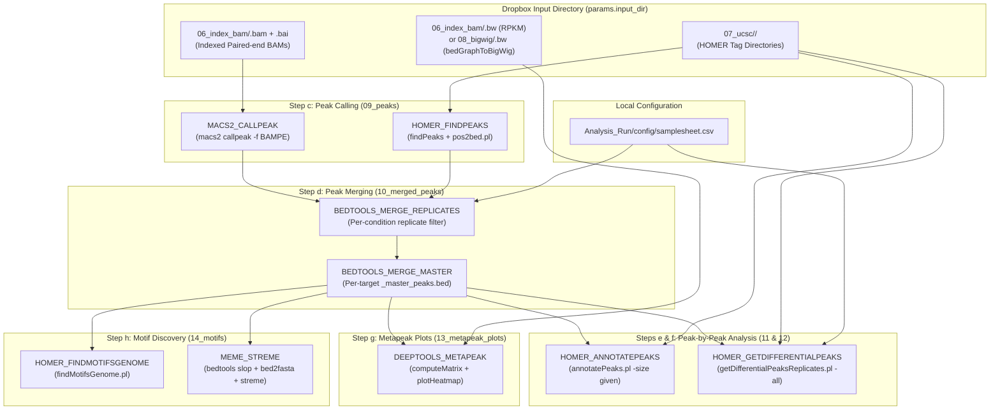

# Simplified CUT&RUN Peak Analysis Pipeline Plan

## 1. Objective & Scope

Simplify the `nf-cutandrun` Nextflow pipeline so that it focuses exclusively on downstream **Peak Analysis**:
1. **Step c — Calling Peaks:** `MACS2_CALLPEAK` and/or `HOMER_FINDPEAKS`
2. **Step d — Merging Peaks:** `BEDTOOLS_MERGE_REPLICATES` and `BEDTOOLS_MERGE_MASTER`
3. **Step e — Peak-by-Peak Quantification & Annotation:** `HOMER_ANNOTATEPEAKS` (`annotatePeaks.pl`)
4. **Step f — Differential Peaks (Optional Toggle):** `HOMER_GETDIFFERENTIALPEAKS` (`getDifferentialPeaksReplicates.pl`)
5. **Step g — Metapeak / Tornado Plots:** `DEEPTOOLS_METAPEAK` (`computeMatrix` + `plotHeatmap`)
6. **Step h — Enriched Motif Discovery (Optional Toggle):** `HOMER_FINDMOTIFSGENOME` and `MEME_STREME`

All upstream steps—adapter trimming, alignment, deduplication, MAPQ/fragment filtering, HOMER tag directory creation, UCSC `bedGraph` track creation, BAM conversion/indexing, and `bigWig` track creation—are completed upstream and stored directly in the Dropbox experiment directory:

```groovy
input_dir = "<dropbox_dir>/Bioinformatics_parent/${params.experiment}"
```

---

## 2. Dropbox Input Directory Structure & Audit (`cut_run103026`)

Verified `<dropbox_dir>/Bioinformatics_parent/cut_run103026`:

```text
<dropbox_dir>/Bioinformatics_parent/cut_run103026/
├── 05_mapq_filter/
│   └── <sample_id>_PicardDedup_mapqfilt.sam  # Filtered SAM files (6 samples)
├── 06_index_bam/
│   ├── <sample_id>.bam                       # Coordinate-sorted BAM files (6 samples)
│   ├── <sample_id>.bam.bai                   # BAM index files (6 samples)
│   └── <sample_id>.bw                        # BigWig files from: bamCoverage -b SAMPLE.bam --normalizeUsing RPKM -o SAMPLE.bw
├── 07_ucsc/
│   └── <sample_id>/                          # HOMER Tag Directory (chr*.tags.tsv, tagInfo.txt, ...) (6 samples)
│       └── <sample_id>.ucsc.bedGraph.gz      # HOMER UCSC bedGraph files
└── 08_bigwig/
    └── <sample_id>.bw                        # BigWig files from: bedGraphToBigWig "$UNZIPPED_BG" "$CHROM_SIZES" "$BIGWIG_OUT"
```

### Dropbox File Checklist for `cut_run103026`
| Required Input | Dropbox Path | Status in Dropbox (`cut_run103026`) | Used By |
| :--- | :--- | :--- | :--- |
| **Indexed BAM Files (`.bam` + `.bam.bai`)** | `${params.input_dir}/06_index_bam/*.bam` | **Ready (All 6 samples)** | `MACS2_CALLPEAK` (`-f BAMPE`) |
| **HOMER Tag Directories** | `${params.input_dir}/07_ucsc/*` | **Ready (All 6 samples)** | `HOMER_FINDPEAKS`, `HOMER_ANNOTATEPEAKS`, `HOMER_GETDIFFERENTIALPEAKS` |
| **UCSC `bedGraph` Files** | `${params.input_dir}/07_ucsc/*/*.ucsc.bedGraph.gz` | **Ready (All 6 samples)** | Genome browser viewing |
| **BigWig Tracks (`bamCoverage` RPKM)** | `${params.input_dir}/06_index_bam/*.bw` | **Ready (All 6 samples)** | `DEEPTOOLS_METAPEAK` (or genome browser) |
| **BigWig Tracks (`bedGraphToBigWig`)** | `${params.input_dir}/08_bigwig/*.bw` | **Ready (All 6 samples)** | `DEEPTOOLS_METAPEAK` (or genome browser) |

---

## 3. Modules, Parameters & Output Directories to Remove

### 3.1 Local Modules to Delete (`nf-cutandrun/modules/local/`)
- `nf-cutandrun/modules/local/samtools_filter_frags/` (`SAMTOOLS_FILTER_FRAGS`)
- `nf-cutandrun/modules/local/samtools_view_index/` (`SAMTOOLS_VIEW_INDEX`)
- `nf-cutandrun/modules/local/homer_maketagdirectory/` (`HOMER_MAKETAGDIRECTORY`)
- `nf-cutandrun/modules/local/homer_makeucscfile/` (`HOMER_MAKEUCSCFILE`)
- `nf-cutandrun/modules/local/deeptools_bamcoverage/` (`DEEPTOOLS_BAMCOVERAGE`)

### 3.2 Output Directories No Longer Created in `Analysis_Run/results/<experiment>/`
- `05_mapq_filter_120bp/` (removed)
- `05_bam/` (removed — already in Dropbox `06_index_bam/`)
- `06_tag_dir/` (removed — already in Dropbox `07_ucsc/`)
- `07_ucsc/` (removed — already in Dropbox `07_ucsc/`)
- `08_bigwig/` (removed — already in Dropbox `06_index_bam/` and `08_bigwig/`)

### 3.3 Config Parameters & Toggles to Remove
- `run_fragment_filter_120bp`
- `run_homer_maketagdirectory`
- `run_homer_makeucscfile`
- `run_sam_to_bam`
- `run_deeptools_bamcoverage`
- `bamcoverage_norm`
- `input_sam`
- `input_ucsc_bedgraph`

---

## 4. Simplified Pipeline Architecture & Workflow DAG



---

## 5. Simplified Configuration Design (`Analysis_Run/config/experiment.config`)

```groovy
params {
    // =========================================================================
    // Experiment & Input / Output Paths
    // =========================================================================
    email                          = "daniel.higgins@umassmed.edu"
    experiment                     = "cut_run103026"
    input_dir                      = "<dropbox_dir>/Bioinformatics_parent/${params.experiment}"
    outdir                         = "${launchDir}/results/${params.experiment}"
    samplesheet                    = "${launchDir}/config/samplesheet.csv"

    // =========================================================================
    // Step Toggles (Turn individual peak analysis steps on/off)
    // =========================================================================
    // Step c: Calling peaks (MACS2 and/or HOMER)
    run_macs2_callpeak             = true
    run_homer_findpeaks            = false

    // Step d: Merging peak files using bedtools
    run_merge_replicate_peaks      = true
    run_merge_master_peaks         = true

    // Step e: Peak-by-peak analysis using HOMER
    run_homer_annotatepeaks        = true

    // Step f: Calling differential peaks using HOMER
    run_homer_diffpeaks            = false

    // Step g: Making metapeak plots (tornado plots) with deepTools
    run_deeptools_metapeak         = true

    // Step h: Looking for enriched motifs in peaks
    run_homer_findmotifs           = true
    run_meme_streme                = false

    // Step d: bedtools replicate & condition peak merging
    active_peak_caller             = "macs2"                 // 'macs2' or 'homer'
    min_replicate_overlap          = 2

    // =========================================================================
    // Input Globs (Dropbox inputs + local peak fallbacks when toggles are false)
    // =========================================================================
    bigwig_source                  = "06_index_bam"          // '06_index_bam' (bamCoverage RPKM) or '08_bigwig' (bedGraphToBigWig)
    input_bam                      = "${params.input_dir}/06_index_bam/*.bam"
    input_tagdirs                  = "${params.input_dir}/07_ucsc/*"
    input_bigwig                   = "${params.input_dir}/${params.bigwig_source}/*.bw"
    input_sample_peaks             = "${params.outdir}/09_peaks/${params.active_peak_caller}/*_peaks.{narrowPeak,broadPeak,bed}"
    input_replicated_peaks         = "${params.outdir}/10_merged_peaks/replicates/*_replicated_peaks.bed"
    input_peaks_bed                = "${params.outdir}/10_merged_peaks/master/*_master_peaks.bed"
}
```

---

## 6. Implementation Steps

1. **Delete Removed Upstream Modules:**
   - Remove `samtools_filter_frags`, `samtools_view_index`, `homer_maketagdirectory`, `homer_makeucscfile`, and `deeptools_bamcoverage` from `nf-cutandrun/modules/local/`.
2. **Update Entrypoint (`nf-cutandrun/main.nf`):**
   - Remove `ch_sam` and `ch_existing_ucsc` channel builders.
   - Resolve `ch_bam_bai` directly from `params.input_bam` (`"${params.input_dir}/06_index_bam/*.bam"`) when `run_macs2_callpeak` is enabled (with 0-byte Dropbox online-only placeholder protection).
   - Resolve `ch_tagdirs` directly from `params.input_tagdirs` (`"${params.input_dir}/07_ucsc/*"`, `type: 'dir'`) whenever `run_homer_findpeaks`, `run_homer_annotatepeaks`, or `run_homer_diffpeaks` is enabled. Strip optional `_tagdir` suffix if present so directory names in `07_ucsc/<sample_id>` match `samplesheet.csv`.
   - Resolve `ch_bigwig` directly from `params.input_bigwig` when `run_deeptools_metapeak` is enabled.
3. **Update Workflow (`nf-cutandrun/workflows/cutandrun.nf`):**
   - Remove upstream module imports and steps (`SAMTOOLS_FILTER_FRAGS`, `HOMER_MAKETAGDIRECTORY`, `HOMER_MAKEUCSCFILE`, `SAMTOOLS_VIEW_INDEX`, `DEEPTOOLS_BAMCOVERAGE`).
   - Accept `ch_bam_bai`, `ch_tagdirs`, `ch_bigwig`, `ch_existing_sample_peaks`, `ch_existing_replicated_peaks`, and `ch_existing_master_peaks`.
4. **Update Config Files (`nf-cutandrun/nextflow.config`, `nf-cutandrun/conf/modules.config`, `Analysis_Run/config/experiment.config`):**
   - Remove upstream toggles, parameters, and `publishDir` rules for `05_mapq_filter_120bp`, `05_bam`, `06_tag_dir`, `07_ucsc`, and `08_bigwig`.
   - Point `input_bam`, `input_tagdirs`, and `input_bigwig` directly to `params.input_dir` in Dropbox.
5. **Verify via `make test` (`make lint` & `make dry-run`):**
   - Run `make test` to validate Nextflow syntax, config resolution, and preview execution against the Dropbox files.
