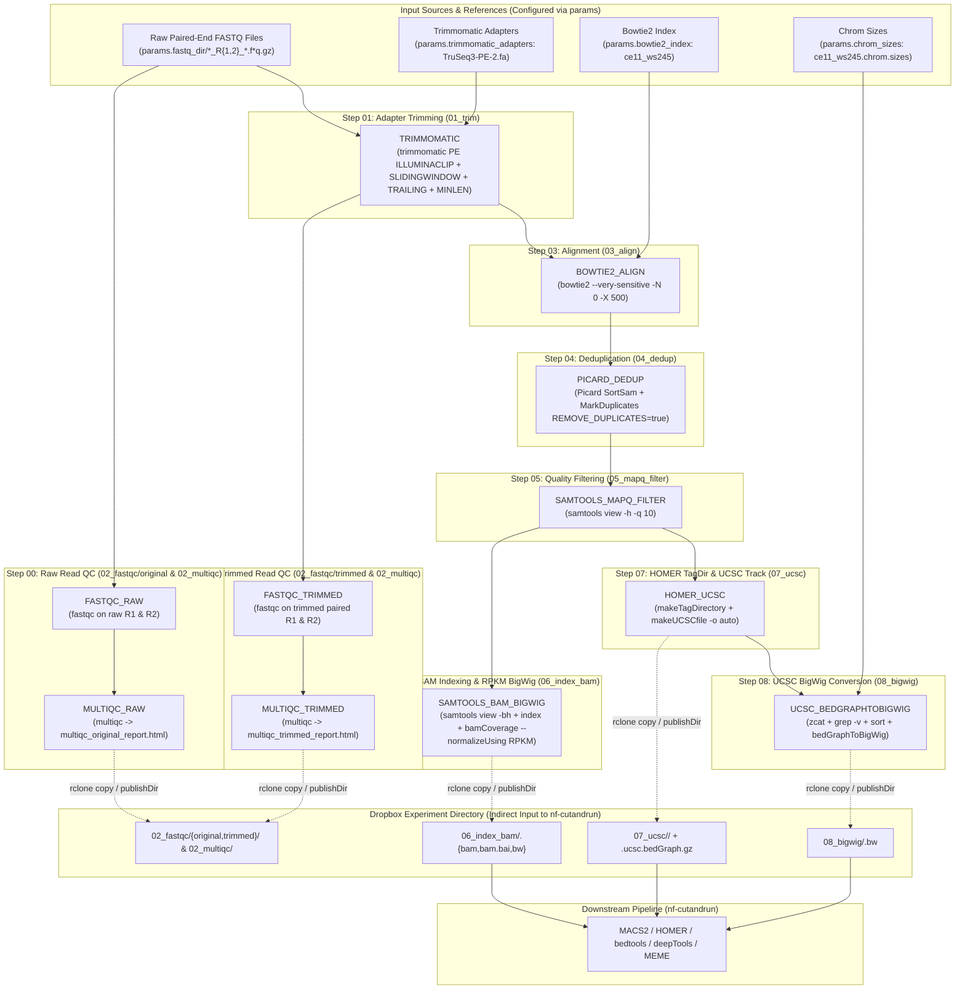

# CUT&RUN Upstream Base Pipeline Plan (`nf-cutandrun-base`)

## 1. Objective & Architectural Overview

Convert all legacy HPC bash scripts in [`nf-cutandrun-base/temp-scripts/`](file:///Users/dan/Code/NextFlow/Cut_And_Run_Analysis/nf-cutandrun-base/temp-scripts) into a modular, toggle-driven Nextflow DSL2 pipeline ([`nf-cutandrun-base/`](file:///Users/dan/Code/NextFlow/Cut_And_Run_Analysis/nf-cutandrun-base)) modeled after [`nf-cutandrun/`](file:///Users/dan/Code/NextFlow/Cut_And_Run_Analysis/nf-cutandrun) and executed via [`Pipeline_Run/`](file:///Users/dan/Code/NextFlow/Cut_And_Run_Analysis/Pipeline_Run).

### End-to-End Pipeline Execution Order
1. **Raw Read QC (`02_fastqc/original` & `02_multiqc`):**
   - Reads raw paired-end FASTQ files from `params.fastq_dir` (e.g., `${params.fastq_dir}/*_R{1,2}_*.f*q.gz`).
   - Runs **FastQC** (`FASTQC_RAW`) on the raw input FASTQ pairs (`02_fastqc/original/`) and aggregates results with **MultiQC** (`MULTIQC_RAW` → `02_multiqc/multiqc_original_report.html`).
2. **Step 01 — Adapter Trimming (`01_trim`):**
   - Runs **Trimmomatic PE** (`TRIMMOMATIC`) on the raw paired-end FASTQ files using `TruSeq3-PE-2.fa` (`ILLUMINACLIP:TruSeq3-PE-2.fa:2:25:7:1:true SLIDINGWINDOW:4:10 TRAILING:3 MINLEN:10`), emitting and publishing only the paired trimmed reads in `01_trim/` (all pipeline data is strictly paired-end).
3. **Trimmed Read QC (`02_fastqc/trimmed` & `02_multiqc`):**
   - Reruns **FastQC** (`FASTQC_TRIMMED`) on the paired trimmed FASTQ outputs from Step 01 (`02_fastqc/trimmed/`) and aggregates results with **MultiQC** (`MULTIQC_TRIMMED` → `02_multiqc/multiqc_trimmed_report.html`).
4. **Step 03 — Genome Alignment (`03_align`):**
   - Aligns the **paired trimmed FASTQ output** from Step 01 against the reference genome (`ce11_ws245`) using **Bowtie2** (`BOWTIE2_ALIGN`, `--very-sensitive -N 0 -X 500 -p 16`), producing `03_align/<sample_id>_bowtieoutput.sam`.
5. **Step 04 — Coordinate Sort & Deduplication (`04_dedup`):**
   - Sorts SAM to coordinate-sorted BAM (`SortSam`) and removes PCR/optical duplicates (`MarkDuplicates REMOVE_DUPLICATES=true`) using **Picard** (`PICARD_DEDUP`), producing `04_dedup/<sample_id>_PicardDedup.bam` and `04_dedup/<sample_id>_dup.txt`.
6. **Step 05 — Low-Quality Read Filtering (`05_mapq_filter`):**
   - Filters deduplicated BAM for `MAPQ >= 10` using **samtools** (`SAMTOOLS_MAPQ_FILTER`, `samtools view -h -q 10`), producing `05_mapq_filter/<sample_id>_PicardDedup_mapqfilt.sam`.
7. **Step 06 — Indexed BAM & deepTools RPKM BigWig (`06_index_bam`):**
   - Converts filtered SAM to indexed BAM (`samtools view -bh` + `samtools index`) and generates RPKM-normalized BigWig tracks (`bamCoverage --normalizeUsing RPKM`) in `06_index_bam/<sample_id>.{bam,bam.bai,bw}`.
8. **Step 07 — HOMER Tag Directory & UCSC `bedGraph` (`07_ucsc`):**
   - Builds HOMER tag directories (`makeTagDirectory`) and UCSC `bedGraph.gz` tracks (`makeUCSCfile -o auto`) in `07_ucsc/<sample_id>/`.
9. **Step 08 — UCSC `bedGraphToBigWig` Conversion (`08_bigwig`):**
   - Formats and sorts the HOMER `bedGraph.gz` track and converts it to BigWig (`bedGraphToBigWig`) in `08_bigwig/<sample_id>.bw`.
10. **Indirect Handoff via Dropbox to `nf-cutandrun`:**
    - Results are synced via `rclone` (`copy_results.sh` / `sync_to_dropbox.sh`) to Dropbox (`remote:Walker_lab_shared/Bioinformatics_parent/${params.experiment}`), where [`nf-cutandrun`](file:///Users/dan/Code/NextFlow/Cut_And_Run_Analysis/nf-cutandrun/main.nf) consumes `06_index_bam/`, `07_ucsc/`, and `08_bigwig/`.

---

## 2. Review & Mapping of `nf-cutandrun-base/temp-scripts`

| Legacy Script(s) | Step / Purpose | Tools & Key Parameters in Script | Input Channel / Source | Published Output Path | Downstream Consumer |
| :--- | :--- | :--- | :--- | :--- | :--- |
| [`02_fastqc.sh`](file:///Users/dan/Code/NextFlow/Cut_And_Run_Analysis/nf-cutandrun-base/temp-scripts/02_fastqc.sh) *(Pre-trim)* | **Step 00a/00b:** FastQC & MultiQC on raw FASTQs | `fastqc/0.11.9` + `multiqc`<br>`fastqc $R1 $R2 -o $OUT_DIR` | Raw paired FASTQs from `params.fastq_dir`<br>(`*_R{1,2}_*.f*q.gz`) | `02_fastqc/original/*_fastqc.{html,zip}`<br>`02_multiqc/multiqc_original_report.html` | Raw sequencing QC report |
| [`01_adapter_trimming.sh`](file:///Users/dan/Code/NextFlow/Cut_And_Run_Analysis/nf-cutandrun-base/temp-scripts/01_adapter_trimming.sh)<br>[`01_generate_trim_jobs.sh`](file:///Users/dan/Code/NextFlow/Cut_And_Run_Analysis/nf-cutandrun-base/temp-scripts/01_generate_trim_jobs.sh) | **Step 01:** Adapter & quality trimming | `trimmomatic-0.39` (`trimmomatic.jar`)<br>`PE $R1 $R2 $OUT_R1_P $OUT_R1_U $OUT_R2_P $OUT_R2_U ILLUMINACLIP:$ADAPTERS:2:25:7:1:true SLIDINGWINDOW:4:10 TRAILING:3 MINLEN:10` | Raw paired FASTQs from `params.fastq_dir` | `01_trim/<sample>_R1_paired.fq.gz`<br>`01_trim/<sample>_R2_paired.fq.gz` | Feeds `FASTQC_TRIMMED` & `BOWTIE2_ALIGN` |
| [`02_fastqc.sh`](file:///Users/dan/Code/NextFlow/Cut_And_Run_Analysis/nf-cutandrun-base/temp-scripts/02_fastqc.sh)<br>[`02_generate_fastqc_jobs.sh`](file:///Users/dan/Code/NextFlow/Cut_And_Run_Analysis/nf-cutandrun-base/temp-scripts/02_generate_fastqc_jobs.sh) | **Step 02a/02b:** FastQC & MultiQC on trimmed FASTQs | `fastqc/0.11.9` + `multiqc`<br>`fastqc $R1_paired $R2_paired -o $OUT_DIR` | Trimmed paired FASTQs from Step 01 (`TRIMMOMATIC.out.trimmed_reads`) | `02_fastqc/trimmed/*_fastqc.{html,zip}`<br>`02_multiqc/multiqc_trimmed_report.html` | Post-trimming QC report |
| [`03_align.sh`](file:///Users/dan/Code/NextFlow/Cut_And_Run_Analysis/nf-cutandrun-base/temp-scripts/03_align.sh)<br>[`03_generate_align_jobs.sh`](file:///Users/dan/Code/NextFlow/Cut_And_Run_Analysis/nf-cutandrun-base/temp-scripts/03_generate_align_jobs.sh) | **Step 03:** Paired-end genome alignment | `bowtie2/2.5.0`, `samtools/1.16.1`<br>`bowtie2 -q --very-sensitive -N 0 -X 500 -p 16 -x $BOWTIE2_INDEX -1 $R1 -2 $R2 -S $SAM_OUT` | Trimmed paired FASTQs from Step 01 (`TRIMMOMATIC.out.trimmed_reads`) | `03_align/<sample>_bowtieoutput.sam`<br>`03_align/<sample>_bowtie2.log` | Feeds Step 04 (`PICARD_DEDUP`) |
| [`04_remove_dups.sh`](file:///Users/dan/Code/NextFlow/Cut_And_Run_Analysis/nf-cutandrun-base/temp-scripts/04_remove_dups.sh)<br>[`04_generate_remove_dups_jobs.sh`](file:///Users/dan/Code/NextFlow/Cut_And_Run_Analysis/nf-cutandrun-base/temp-scripts/04_generate_remove_dups_jobs.sh) | **Step 04:** Coordinate sort & duplicate removal | `picard.jar` (`2.5.0`) + `samtools/1.16.1`<br>1. `SortSam` (`SORT_ORDER=coordinate`, `VALIDATION_STRINGENCY=LENIENT`)<br>2. `MarkDuplicates` (`REMOVE_DUPLICATES=true`, `VALIDATION_STRINGENCY=LENIENT`) | `03_align/<sample>_bowtieoutput.sam` | `04_dedup/<sample>_PicardSort.bam`<br>`04_dedup/<sample>_PicardDedup.bam`<br>`04_dedup/<sample>_dup.txt` | Feeds Step 05 (`SAMTOOLS_MAPQ_FILTER`) |
| [`05_remove_low_qual.sh`](file:///Users/dan/Code/NextFlow/Cut_And_Run_Analysis/nf-cutandrun-base/temp-scripts/05_remove_low_qual.sh)<br>[`05_generate_remove_low_qual_jobs.sh`](file:///Users/dan/Code/NextFlow/Cut_And_Run_Analysis/nf-cutandrun-base/temp-scripts/05_generate_remove_low_qual_jobs.sh) | **Step 05:** Remove low-MAPQ reads | `samtools/1.16.1`<br>`samtools view -h -q 10 $BAM_IN > $SAM_OUT` | `04_dedup/<sample>_PicardDedup.bam` | `05_mapq_filter/<sample>_PicardDedup_mapqfilt.sam` | Feeds Step 06 & Step 07 |
| [`06_index_bam.sh`](file:///Users/dan/Code/NextFlow/Cut_And_Run_Analysis/nf-cutandrun-base/temp-scripts/06_index_bam.sh)<br>[`06_generate_index_bam.sh`](file:///Users/dan/Code/NextFlow/Cut_And_Run_Analysis/nf-cutandrun-base/temp-scripts/06_generate_index_bam.sh) | **Step 06:** SAM→BAM conversion, indexing, & RPKM BigWig | `samtools/1.16.1`, `deeptools/3.5.6`<br>1. `samtools view -bh $SAM_IN > $BAM_OUT`<br>2. `samtools index $BAM_OUT`<br>3. `bamCoverage -b $BAM_OUT --normalizeUsing RPKM -o $BW_OUT` | `05_mapq_filter/<sample>_PicardDedup_mapqfilt.sam` | `06_index_bam/<sample>.bam`<br>`06_index_bam/<sample>.bam.bai`<br>`06_index_bam/<sample>.bw` | **Direct input to `nf-cutandrun`:**<br>- `MACS2_CALLPEAK` (`.bam` + `.bam.bai`)<br>- `DEEPTOOLS_METAPEAK` (`.bw` when `bigwig_source = '06_index_bam'`) |
| [`07_ucsc_file.sh`](file:///Users/dan/Code/NextFlow/Cut_And_Run_Analysis/nf-cutandrun-base/temp-scripts/07_ucsc_file.sh)<br>[`07_generate_ucsc_file_jobs.sh`](file:///Users/dan/Code/NextFlow/Cut_And_Run_Analysis/nf-cutandrun-base/temp-scripts/07_generate_ucsc_file_jobs.sh) | **Step 07:** HOMER Tag Directory & UCSC `bedGraph` | `homer_env/4.11`, `~/software/homer/bin`, `samtools/1.16.1`<br>1. `makeTagDirectory $TAG_DIR $SAM_IN`<br>2. `makeUCSCfile $TAG_DIR -o auto` | `05_mapq_filter/<sample>_PicardDedup_mapqfilt.sam` | `07_ucsc/<sample>/` (TagDir)<br>`07_ucsc/<sample>/<sample>.ucsc.bedGraph.gz` | **Direct input to `nf-cutandrun`:**<br>- `HOMER_FINDPEAKS`<br>- `HOMER_ANNOTATEPEAKS`<br>- `HOMER_GETDIFFERENTIALPEAKS`<br>- Also feeds Step 08 (`UCSC_BIGWIG`) |
| [`08_bigwig.sh`](file:///Users/dan/Code/NextFlow/Cut_And_Run_Analysis/nf-cutandrun-base/temp-scripts/08_bigwig.sh)<br>[`08_generate_bigwig_jobs.sh`](file:///Users/dan/Code/NextFlow/Cut_And_Run_Analysis/nf-cutandrun-base/temp-scripts/08_generate_bigwig_jobs.sh) | **Step 08:** UCSC `bedGraph` to BigWig track | `ucsc_utilities/20240312`<br>1. Strip `#`/`track` lines & `sort -k1,1 -k2,2n`<br>2. `bedGraphToBigWig $UNZIPPED_BG $CHROM_SIZES $BIGWIG_OUT` | `07_ucsc/<sample>/<sample>.ucsc.bedGraph.gz`<br>+ `ce11_ws245.chrom.sizes` | `08_bigwig/<sample>.bw` | **Direct input to `nf-cutandrun`:**<br>- `DEEPTOOLS_METAPEAK` (`.bw` when `bigwig_source = '08_bigwig'`) |
| [`copy_results.sh`](file:///Users/dan/Code/NextFlow/Cut_And_Run_Analysis/nf-cutandrun-base/temp-scripts/copy_results.sh) | Sync results to Dropbox | `rclone copy -P -vv ./results/<step> ${REMOTE_DIR}/<step>` | Local `results/01_trim..08_bigwig` | Dropbox `<experiment>/01_trim..08_bigwig` | Populates `params.input_dir` for `nf-cutandrun` |
| [`submit_short.sh`](file:///Users/dan/Code/NextFlow/Cut_And_Run_Analysis/nf-cutandrun-base/temp-scripts/submit_short.sh) | LSF job wrapper | `bsub -q short -W 6:00 -n 4 -R "rusage[mem=16GB]"` | `jobs/*/*.sh` | LSF job submission | Replaced by Nextflow `lsf` executor profile |

---

## 3. Pipeline Architecture & Workflow DAG



---

## 4. Sample Naming & Indirect Dropbox Contract with `nf-cutandrun`

To guarantee seamless handoff from raw FASTQ files through `01_trim`..`08_bigwig` and into [`nf-cutandrun`](file:///Users/dan/Code/NextFlow/Cut_And_Run_Analysis/nf-cutandrun/main.nf):

1. **Configurable Raw FASTQ Location (`params.fastq_dir` & `params.input_fastq`):**
   - `params.fastq_dir` specifies the directory containing the raw paired-end FASTQ files (e.g., `"${launchDir}/data/fastq"` on HPC or `"${params.dropbox_dir}/fastq"`).
   - `params.input_fastq` defaults to `"${params.fastq_dir}/*_R{1,2}_*.f*q.gz"` (matching `01_generate_trim_jobs.sh`: `for R1 in "$DATA_DIR"/*_R1_*.f*q.gz`).
   - Sample ID (`meta.id`) is derived by stripping the `_R1_*` / `_R2_*` suffix (e.g., `L9254-0001-0001_S141_L004_R1_001.fastq.gz` → `meta.id = "L9254-0001-0001_S141_L004"`), exactly matching `SAMPLE=${BASENAME%_R1_*}` in [`01_generate_trim_jobs.sh`](file:///Users/dan/Code/NextFlow/Cut_And_Run_Analysis/nf-cutandrun-base/temp-scripts/01_generate_trim_jobs.sh#L24) and `sample_id` in [`Analysis_Run/config/samplesheet.csv`](file:///Users/dan/Code/NextFlow/Cut_And_Run_Analysis/Analysis_Run/config/samplesheet.csv).
2. **Trimmed Read Naming & Flow into FastQC + Bowtie2 (Paired-End Only):**
   - All input and output sequencing data is strictly paired-end.
   - `TRIMMOMATIC` emits and publishes only the paired trimmed reads (`${meta.id}_R1_paired.fq.gz` and `${meta.id}_R2_paired.fq.gz`) to `${params.outdir}/01_trim/` (discarding temporary unpaired Trimmomatic files).
   - Both `FASTQC_TRIMMED` and `BOWTIE2_ALIGN` consume `TRIMMOMATIC.out.trimmed_reads` (`tuple val(meta), path([r1_paired, r2_paired])`) directly.
   - If `run_trimmomatic = false`, the pipeline falls back to `params.input_trimmed_fastq` (`"${params.outdir}/01_trim/*{_R1_paired.fq.gz,_R2_paired.fq.gz,.paired.trim_1.fastq.gz,.paired.trim_2.fastq.gz}"`), supporting both `01_adapter_trimming.sh` and legacy `01_trim` naming.
3. **Output Directory Contract (`${params.outdir}` → Dropbox `${params.experiment}`):**
   - `01_trim/<sample_id>_R{1,2}_paired.fq.gz`
   - `02_fastqc/original/*_fastqc.{html,zip}` & `02_fastqc/trimmed/*_fastqc.{html,zip}`
   - `02_multiqc/multiqc_original_report.html` (+ `_data/`) & `02_multiqc/multiqc_trimmed_report.html` (+ `_data/`)
   - `03_align/<sample_id>_bowtieoutput.sam` (+ `<sample_id>_bowtie2.log`)
   - `04_dedup/<sample_id>_dup.txt` (+ `<sample_id>_PicardDedup.bam` when `publish_dedup_bam = true`)
   - `05_mapq_filter/<sample_id>_PicardDedup_mapqfilt.sam`
   - `06_index_bam/<sample_id>.bam`, `06_index_bam/<sample_id>.bam.bai`, `06_index_bam/<sample_id>.bw`
     - Consumed by `nf-cutandrun` via `params.input_bam = "${params.input_dir}/06_index_bam/*.bam"` and `params.bigwig_source = "06_index_bam"`.
   - `07_ucsc/<sample_id>/` (containing HOMER tag files and `<sample_id>.ucsc.bedGraph.gz`)
     - Consumed by `nf-cutandrun` via `params.input_tagdirs = "${params.input_dir}/07_ucsc/*"`.
   - `08_bigwig/<sample_id>.bw`
     - Consumed by `nf-cutandrun` via `params.bigwig_source = "08_bigwig"` (`"${params.input_dir}/08_bigwig/*.bw"`).

---

## 5. Directory & File Structure to Create

Following the exact conventions of [`nf-cutandrun`](file:///Users/dan/Code/NextFlow/Cut_And_Run_Analysis/nf-cutandrun) and [`Analysis_Run`](file:///Users/dan/Code/NextFlow/Cut_And_Run_Analysis/Analysis_Run):

```text
Cut_And_Run_Analysis/
├── pipeline_plan.md                              # This architectural plan
├── Makefile                                      # Targets for both base (Pipeline_Run) & analysis (Analysis_Run)
├── Pipeline_Run/                                 # Execution directory for nf-cutandrun-base (HPC)
│   ├── run.sh                                    # Launches ../nf-cutandrun-base with config/experiment.config
│   ├── sync_from_dropbox.sh                      # Optional rclone helper to pull raw fastq/ from Dropbox
│   ├── sync_to_dropbox.sh                        # Optional rclone helper replacing copy_results.sh
│   └── config/
│       ├── experiment.config                     # Experiment-specific parameters, toggles, & HPC paths
│       └── samplesheet.csv                       # Optional sample metadata sheet
└── nf-cutandrun-base/                            # Nextflow DSL2 Upstream Pipeline
    ├── main.nf                                   # Entrypoint: CLI help, input channel resolution (compute or reuse)
    ├── nextflow.config                           # Global defaults, profiles (hpc/lsf, singularity, apptainer, docker, conda)
    ├── workflows/
    │   └── cutandrun_base.nf                     # Main DSL2 workflow connecting Raw QC -> Step 01 -> Trimmed QC -> Steps 03–08
    ├── conf/
    │   ├── base.config                           # Process resource labels (process_single, process_low, process_medium, process_high)
    │   └── modules.config                        # Per-module ext.args, publishDir rules (01_trim..08_bigwig), and HPC module names
    └── modules/
        └── local/
            ├── fastqc/
            │   ├── main.nf                       # FastQC module (reused as FASTQC_RAW and FASTQC_TRIMMED via module aliasing)
            │   └── environment.yml
            ├── multiqc/
            │   ├── main.nf                       # MultiQC module (reused as MULTIQC_RAW and MULTIQC_TRIMMED via module aliasing)
            │   └── environment.yml
            ├── trimmomatic/
            │   ├── main.nf                       # Step 01: Trimmomatic PE adapter & sliding-window trimming
            │   └── environment.yml
            ├── bowtie2_align/
            │   ├── main.nf                       # Step 03: Bowtie2 alignment to SAM
            │   └── environment.yml
            ├── picard_dedup/
            │   ├── main.nf                       # Step 04: Picard SortSam + MarkDuplicates
            │   └── environment.yml
            ├── samtools_mapq_filter/
            │   ├── main.nf                       # Step 05: samtools view -h -q MAPQ
            │   └── environment.yml
            ├── samtools_bam_bigwig/
            │   ├── main.nf                       # Step 06: samtools view -bh + index + deeptools bamCoverage RPKM
            │   └── environment.yml
            ├── homer_ucsc/
            │   ├── main.nf                       # Step 07: HOMER makeTagDirectory + makeUCSCfile -o auto
            │   └── environment.yml
            └── ucsc_bedgraphtobigwig/
                ├── main.nf                       # Step 08: bedGraph decompression, sorting, and bedGraphToBigWig
                └── environment.yml
```

---

## 6. Module Specifications (`nf-cutandrun-base/modules/local/`)

Each module follows the `nf-core` DSL2 pattern used in `nf-cutandrun`, supporting:
- **HPC Environment Modules (`module` directive / `$TRIMMOMATIC_JAR` / `$PICARD_JAR`)** when run with `-profile hpc`.
- **Containers (Singularity/Apptainer/Docker) & Conda (`environment.yml`)** for portable execution.
- **`stub:` blocks** so the entire pipeline can be dry-run and stub-tested locally on macOS without requiring HPC genome indexes.

### 6.1 `FASTQC` (Aliased as `FASTQC_RAW` & `FASTQC_TRIMMED` — `02_fastqc.sh`)
- **Label:** `process_low` (4 CPUs, 16 GB RAM, 6h walltime on HPC).
- **HPC Module:** `fastqc/0.11.9`
- **Inputs:**
  - `tuple val(meta), path(reads)` (where `reads` is `[r1, r2]`)
- **Outputs:**
  - `tuple val(meta), path("*_fastqc.html"), emit: html`
  - `tuple val(meta), path("*_fastqc.zip"), emit: zip`
  - `versions` topic emission
- **Script:**
  ```bash
  fastqc \\
      ${args} \\
      -t ${task.cpus} \\
      -o . \\
      ${reads}
  ```
- **Publish Directories (via `conf/modules.config`):**
  - `withName: 'FASTQC_RAW'` → `${params.outdir}/02_fastqc/original`
  - `withName: 'FASTQC_TRIMMED'` → `${params.outdir}/02_fastqc/trimmed`

### 6.2 `MULTIQC` (Aliased as `MULTIQC_RAW` & `MULTIQC_TRIMMED`)
- **Label:** `process_single`
- **HPC Module / Tooling:** `multiqc` (via module or container/conda)
- **Inputs:**
  - `path(qc_files)` (collected `*_fastqc.zip` across all samples)
  - `val(report_name)` (`"multiqc_original_report"` for raw, `"multiqc_trimmed_report"` for trimmed)
- **Outputs:**
  - `path("${report_name}.html"), emit: report`
  - `path("${report_name}_data"), emit: data`
  - `versions` topic emission
- **Script:**
  ```bash
  multiqc \\
      ${args} \\
      -f \\
      -n "${report_name}.html" \\
      .
  ```
- **Publish Directory:** `${params.outdir}/02_multiqc` (matches Dropbox `02_multiqc/multiqc_original_report.html` and `02_multiqc/multiqc_trimmed_report.html`).

### 6.3 `TRIMMOMATIC` (Step 01 — `01_adapter_trimming.sh`)
- **Label:** `process_medium` (4 CPUs, 16 GB RAM, 6h walltime).
- **HPC Tooling:** Supports either `java -jar ${params.trimmomatic_jar}` (where default HPC `trimmomatic_jar = "/pi/thomas.fazzio-umw/conda/pkgs/trimmomatic-0.39-hdfd78af_2/share/trimmomatic-0.39-2/trimmomatic.jar"`) or `trimmomatic` CLI in Conda/Biocontainers.
- **Inputs:**
  - `tuple val(meta), path(reads)` (raw `[r1, r2]` from `params.fastq_dir`)
  - `path(adapters)` (`params.trimmomatic_adapters`, default `/pi/thomas.fazzio-umw/conda/pkgs/trimmomatic-0.39-hdfd78af_2/share/trimmomatic-0.39-2/adapters/TruSeq3-PE-2.fa`)
- **Outputs:**
  - `tuple val(meta), path(["${prefix}_R1_paired.fq.gz", "${prefix}_R2_paired.fq.gz"]), emit: trimmed_reads`
  - `tuple val(meta), path("${prefix}_trimmomatic.log"), emit: log`
  - `versions` topic emission
- **Script:**
  ```bash
  TRIMMOMATIC_CMD="trimmomatic"
  if [[ -n "${params.trimmomatic_jar ?: ''}" && -f "${params.trimmomatic_jar ?: ''}" ]]; then
      TRIMMOMATIC_CMD="java -jar ${params.trimmomatic_jar}"
  fi

  \$TRIMMOMATIC_CMD PE \\
      -threads ${task.cpus} \\
      "${reads[0]}" "${reads[1]}" \\
      "${prefix}_R1_paired.fq.gz" "${prefix}_R1_unpaired.tmp.fq.gz" \\
      "${prefix}_R2_paired.fq.gz" "${prefix}_R2_unpaired.tmp.fq.gz" \\
      ILLUMINACLIP:"${adapters}":${params.trimmomatic_illuminaclip} \\
      ${args} \\
      2> "${prefix}_trimmomatic.log"

  rm -f "${prefix}_R1_unpaired.tmp.fq.gz" "${prefix}_R2_unpaired.tmp.fq.gz"
  ```
  *(Default `params.trimmomatic_illuminaclip`: `"2:25:7:1:true"`; default `ext.args`: `"SLIDINGWINDOW:4:10 TRAILING:3 MINLEN:10"`, matching `01_adapter_trimming.sh` lines 78–79).*
- **Publish Directory:** `${params.outdir}/01_trim`

### 6.4 `BOWTIE2_ALIGN` (Step 03 — `03_align.sh`)
- **Label:** `process_high` (16 CPUs, 16 GB RAM, 6h walltime to match `bowtie2 -p 16`).
- **HPC Modules:** `bowtie2/2.5.0`, `samtools/1.16.1`
- **Inputs:**
  - `tuple val(meta), path(reads)` (trimmed `[r1_paired, r2_paired]` from `TRIMMOMATIC.out.trimmed_reads`)
  - `val(bowtie2_index)` (`params.bowtie2_index`)
- **Outputs:**
  - `tuple val(meta), path("${prefix}_bowtieoutput.sam"), emit: sam`
  - `tuple val(meta), path("${prefix}_bowtie2.log"), emit: log`
  - `versions` topic emission
- **Script:**
  ```bash
  bowtie2 -q \\
      ${args} \\
      -p ${task.cpus} \\
      -x "${bowtie2_index}" \\
      -1 "${reads[0]}" \\
      -2 "${reads[1]}" \\
      -S "${prefix}_bowtieoutput.sam" \\
      2> "${prefix}_bowtie2.log"
  ```
  *(Default `ext.args`: `--very-sensitive -N 0 -X 500`)*
- **Publish Directory:** `${params.outdir}/03_align`

### 6.5 `PICARD_DEDUP` (Step 04 — `04_remove_dups.sh`)
- **Label:** `process_medium` (4 CPUs, 16 GB RAM, 6h walltime).
- **HPC Modules / Tooling:** `samtools/1.16.1` + `java -Xmx4g -jar ${params.picard_jar}` (or `picard` CLI in container/conda).
- **Inputs:**
  - `tuple val(meta), path(sam)`
- **Outputs:**
  - `tuple val(meta), path("${prefix}_PicardDedup.bam"), emit: dedup_bam`
  - `tuple val(meta), path("${prefix}_PicardSort.bam"), emit: sorted_bam, optional: true`
  - `tuple val(meta), path("${prefix}_dup.txt"), emit: metrics`
  - `versions` topic emission
- **Script:**
  ```bash
  mkdir -p tmp
  PICARD_CMD="picard"
  if [[ -n "${params.picard_jar ?: ''}" && -f "${params.picard_jar ?: ''}" ]]; then
      PICARD_CMD="java -Xmx${avail_mem}g -jar ${params.picard_jar}"
  else
      PICARD_CMD="picard -Xmx${avail_mem}g"
  fi

  \$PICARD_CMD SortSam \\
      INPUT="${sam}" \\
      OUTPUT="${prefix}_PicardSort.bam" \\
      ${args} \\
      TMP_DIR="./tmp"

  \$PICARD_CMD MarkDuplicates \\
      INPUT="${prefix}_PicardSort.bam" \\
      OUTPUT="${prefix}_PicardDedup.bam" \\
      METRICS_FILE="${prefix}_dup.txt" \\
      ${args2} \\
      TMP_DIR="./tmp"
  ```
  *(Default `ext.args`: `VALIDATION_STRINGENCY=LENIENT SORT_ORDER=coordinate`; default `ext.args2`: `VALIDATION_STRINGENCY=LENIENT REMOVE_DUPLICATES=true`)*
- **Publish Directory:** `${params.outdir}/04_dedup`

### 6.6 `SAMTOOLS_MAPQ_FILTER` (Step 05 — `05_remove_low_qual.sh`)
- **Label:** `process_low`
- **HPC Modules:** `samtools/1.16.1`
- **Inputs:**
  - `tuple val(meta), path(dedup_bam)`
- **Outputs:**
  - `tuple val(meta), path("${prefix}_PicardDedup_mapqfilt.sam"), emit: sam`
  - `versions` topic emission
- **Script:**
  ```bash
  samtools view -@ ${task.cpus} -h ${args} "${dedup_bam}" > "${prefix}_PicardDedup_mapqfilt.sam"
  ```
  *(Default `ext.args`: `-q ${params.mapq_threshold}` where `params.mapq_threshold = 10`)*
- **Publish Directory:** `${params.outdir}/05_mapq_filter`

### 6.7 `SAMTOOLS_BAM_BIGWIG` (Step 06 — `06_index_bam.sh`)
- **Label:** `process_medium`
- **HPC Modules:** `samtools/1.16.1`, `deeptools/3.5.6`
- **Inputs:**
  - `tuple val(meta), path(mapq_sam)`
- **Outputs:**
  - `tuple val(meta), path("${prefix}.bam"), path("${prefix}.bam.bai"), emit: bam_bai`
  - `tuple val(meta), path("${prefix}.bw"), emit: bigwig`
  - `versions` topic emission
- **Script:**
  ```bash
  samtools view -@ ${task.cpus} -bh "${mapq_sam}" > "${prefix}.bam"
  samtools index -@ ${task.cpus} "${prefix}.bam"
  bamCoverage -b "${prefix}.bam" -p ${task.cpus} ${args} -o "${prefix}.bw"
  ```
  *(Default `ext.args`: `--normalizeUsing ${params.bamcoverage_norm}` where `params.bamcoverage_norm = 'RPKM'`)*
- **Publish Directory:** `${params.outdir}/06_index_bam`

### 6.8 `HOMER_UCSC` (Step 07 — `07_ucsc_file.sh`)
- **Label:** `process_medium`
- **HPC Modules:** `homer_env/4.11`, `samtools/1.16.1` (plus `export PATH=${params.homer_bin_dir}:\$PATH`).
- **Inputs:**
  - `tuple val(meta), path(mapq_sam)`
- **Outputs:**
  - `tuple val(meta), path("${prefix}"), emit: tagdir`
  - `tuple val(meta), path("${prefix}/${prefix}.ucsc.bedGraph.gz"), emit: bedgraph`
  - `versions` topic emission
- **Script:**
  ```bash
  mkdir -p "${prefix}"
  makeTagDirectory "${prefix}" "${mapq_sam}" ${args}
  makeUCSCfile "${prefix}" -o auto ${args2}
  ```
- **Publish Directory:** `${params.outdir}/07_ucsc`

### 6.9 `UCSC_BEDGRAPHTOBIGWIG` (Step 08 — `08_bigwig.sh`)
- **Label:** `process_low`
- **HPC Modules:** `ucsc_utilities/20240312`
- **Inputs:**
  - `tuple val(meta), path(bedgraph)`
  - `path(chrom_sizes)`
- **Outputs:**
  - `tuple val(meta), path("${prefix}.bw"), emit: bigwig`
  - `versions` topic emission
- **Script:**
  ```bash
  if [[ "${bedgraph}" =~ \.gz\$ ]]; then
      gzip -dc "${bedgraph}"
  else
      cat "${bedgraph}"
  fi | grep -v '^#' | grep -v '^track' | LC_COLLATE=C sort -k1,1 -k2,2n > "${prefix}.temp.bedGraph"

  bedGraphToBigWig "${prefix}.temp.bedGraph" "${chrom_sizes}" "${prefix}.bw"
  rm -f "${prefix}.temp.bedGraph"
  ```
- **Publish Directory:** `${params.outdir}/08_bigwig`

---

## 7. Toggle-Driven Execution & Step-Skip/Reuse Logic

Just like `nf-cutandrun`, `nf-cutandrun-base` allows toggling individual steps on/off in [`Pipeline_Run/config/experiment.config`](file:///Users/dan/Code/NextFlow/Cut_And_Run_Analysis/Pipeline_Run/config/experiment.config) and automatically resolving pre-existing files when an upstream step is disabled:

| Step Toggle Parameter | Default | Description & Channel Resolution |
| :--- | :---: | :--- |
| `run_raw_fastqc` | `true` | Runs `FASTQC_RAW` (`02_fastqc/original`) + `MULTIQC_RAW` (`02_multiqc/multiqc_original_report.html`) on raw FASTQs from `params.fastq_dir`. |
| `run_trimmomatic` | `true` | Runs `TRIMMOMATIC` (`01_trim`). When `false`, resolves trimmed paired FASTQs from `params.input_trimmed_fastq`. |
| `run_trimmed_fastqc` | `true` | Runs `FASTQC_TRIMMED` (`02_fastqc/trimmed`) + `MULTIQC_TRIMMED` (`02_multiqc/multiqc_trimmed_report.html`) on trimmed FASTQs. |
| `run_bowtie2_align` | `true` | Runs `BOWTIE2_ALIGN` (`03_align`) on trimmed FASTQs. When `false`, resolves SAM files from `params.input_align_sam`. |
| `run_picard_dedup` | `true` | Runs `PICARD_DEDUP` (`04_dedup`). When `false`, resolves deduplicated BAMs from `params.input_dedup_bam`. |
| `run_mapq_filter` | `true` | Runs `SAMTOOLS_MAPQ_FILTER` (`05_mapq_filter`). When `false`, resolves filtered SAMs from `params.input_mapq_sam`. |
| `run_index_bam` | `true` | Runs `SAMTOOLS_BAM_BIGWIG` (`06_index_bam` → `.bam`, `.bam.bai`, `.bw`). |
| `run_homer_ucsc` | `true` | Runs `HOMER_UCSC` (`07_ucsc` → TagDir + `.ucsc.bedGraph.gz`). When `false`, resolves `params.input_bedgraph` for Step 08. |
| `run_ucsc_bigwig` | `true` | Runs `UCSC_BEDGRAPHTOBIGWIG` (`08_bigwig` → `.bw`). |

---

## 8. Configuration Design (`Pipeline_Run/config/experiment.config`)

```groovy
/*
~~~~~~~~~~~~~~~~~~~~~~~~~~~~~~~~~~~~~~~~~~~~~~~~~~~~~~~~~~~~~~~~~~~~~~~~~~~~~~~~~~~~~~~~
    Experiment Configuration for CUT&RUN Upstream Base Pipeline (HPC)
~~~~~~~~~~~~~~~~~~~~~~~~~~~~~~~~~~~~~~~~~~~~~~~~~~~~~~~~~~~~~~~~~~~~~~~~~~~~~~~~~~~~~~~~
    Run from Pipeline_Run/:
      ./run.sh -profile hpc
    or:
      nextflow -c config/experiment.config run ../nf-cutandrun-base -profile hpc -resume
----------------------------------------------------------------------------------------
*/

params {
    // =========================================================================
    // Experiment & Input / Output Paths
    // =========================================================================
    email                          = "daniel.higgins@umassmed.edu"
    experiment                     = "cut_run103026"
    fastq_dir                      = "${launchDir}/data/fastq"
    outdir                         = "${launchDir}/results/${params.experiment}"
    samplesheet                    = "${launchDir}/config/samplesheet.csv"

    // Optional rclone remote path for Dropbox staging & publishing
    rclone_remote                  = "remote:Walker_lab_shared/Bioinformatics_parent/${params.experiment}"

    // =========================================================================
    // Step Toggles (Turn individual upstream processing steps on/off)
    // =========================================================================
    run_raw_fastqc                 = true    // Step 00: FastQC + MultiQC on raw FASTQs
    run_trimmomatic                = true    // Step 01: Trimmomatic PE adapter trimming
    run_trimmed_fastqc             = true    // Step 02: FastQC + MultiQC on trimmed FASTQs
    run_bowtie2_align              = true    // Step 03: Bowtie2 alignment on trimmed FASTQs
    run_picard_dedup               = true    // Step 04: Picard SortSam + MarkDuplicates
    run_mapq_filter                = true    // Step 05: samtools view -q 10
    run_index_bam                  = true    // Step 06: samtools BAM + index + bamCoverage RPKM BigWig
    run_homer_ucsc                 = true    // Step 07: HOMER makeTagDirectory + makeUCSCfile
    run_ucsc_bigwig                = true    // Step 08: UCSC bedGraphToBigWig

    // Output publishing controls for large intermediate files
    publish_align_sam              = true    // Publish 03_align/*_bowtieoutput.sam
    publish_dedup_bam              = false   // Keep 04_dedup/*.bam in work/ only; publish *_dup.txt
    publish_mapq_sam               = true    // Publish 05_mapq_filter/*_PicardDedup_mapqfilt.sam

    // =========================================================================
    // Input Globs (Primary FASTQ input & step-skip fallbacks)
    // =========================================================================
    input_fastq                    = "${params.fastq_dir}/*_R{1,2}_*.f*q.gz"
    input_trimmed_fastq            = "${params.outdir}/01_trim/*{_R1_paired.fq.gz,_R2_paired.fq.gz,.paired.trim_1.fastq.gz,.paired.trim_2.fastq.gz}"
    input_align_sam                = "${params.outdir}/03_align/*_bowtieoutput.sam"
    input_dedup_bam                = "${params.outdir}/04_dedup/*_PicardDedup.bam"
    input_mapq_sam                 = "${params.outdir}/05_mapq_filter/*_PicardDedup_mapqfilt.sam"
    input_bedgraph                 = "${params.outdir}/07_ucsc/*/*.ucsc.bedGraph.gz"

    // =========================================================================
    // HPC Reference & Tool Paths (C. elegans ce11_ws245 defaults)
    // =========================================================================
    trimmomatic_dir                = "/pi/thomas.fazzio-umw/conda/pkgs/trimmomatic-0.39-hdfd78af_2/share/trimmomatic-0.39-2"
    trimmomatic_jar                = "${params.trimmomatic_dir}/trimmomatic.jar"
    trimmomatic_adapters           = "${params.trimmomatic_dir}/adapters/TruSeq3-PE-2.fa"
    bowtie2_index                  = "/share/data/umw_biocore/genome_data/c_elegans/ce11_ws245/ce11_ws245"
    chrom_sizes                    = "/share/data/umw_biocore/genome_data/c_elegans/ce11_ws245/ce11_ws245.chrom.sizes"
    picard_jar                     = "/pi/thomas.fazzio-umw/Sarah/picard-tools-2.5.0/picard.jar"
    homer_bin_dir                  = "\$HOME/software/homer/bin"

    // =========================================================================
    // Tool-Specific Parameters
    // =========================================================================
    // Step 01: Trimmomatic parameters
    trimmomatic_illuminaclip       = "2:25:7:1:true"
    trimmomatic_args               = "SLIDINGWINDOW:4:10 TRAILING:3 MINLEN:10"

    // Step 03: Bowtie2 parameters
    bowtie2_args                   = "--very-sensitive -N 0 -X 500"

    // Step 04: Picard parameters
    picard_validation_stringency   = "LENIENT"
    picard_remove_duplicates       = true

    // Step 05: samtools MAPQ filter
    mapq_threshold                 = 10

    // Step 06: deepTools bamCoverage
    bamcoverage_norm               = "RPKM"

    // LSF Queue Settings
    lsf_queue                      = "short"
}
```

---

## 9. HPC Profile (`nf-cutandrun-base/nextflow.config`)

Configured to match [`submit_short.sh`](file:///Users/dan/Code/NextFlow/Cut_And_Run_Analysis/nf-cutandrun-base/temp-scripts/submit_short.sh) (`bsub -q short -W 6:00 -n 4 -R "rusage[mem=16GB]"`) and the module loads in `temp-scripts`:

```groovy
profiles {
    hpc {
        executor {
            name           = 'lsf'
            perJobMemLimit = true
        }
        process {
            executor       = 'lsf'
            queue          = { params.lsf_queue ?: 'short' }

            withName: 'FASTQC_RAW|FASTQC_TRIMMED' {
                cpus   = 4
                memory = 16.GB
                time   = 6.h
                module = 'fastqc/0.11.9'
            }
            withName: 'MULTIQC_RAW|MULTIQC_TRIMMED' {
                cpus   = 2
                memory = 8.GB
                time   = 2.h
                module = { params.multiqc_module ?: '' }
            }
            withName: 'TRIMMOMATIC' {
                cpus   = 4
                memory = 16.GB
                time   = 6.h
            }
            withName: 'BOWTIE2_ALIGN' {
                cpus   = 16
                memory = 16.GB
                time   = 6.h
                module = 'bowtie2/2.5.0:samtools/1.16.1'
            }
            withName: 'PICARD_DEDUP' {
                cpus   = 4
                memory = 16.GB
                time   = 6.h
                module = 'samtools/1.16.1'
            }
            withName: 'SAMTOOLS_MAPQ_FILTER' {
                cpus   = 4
                memory = 16.GB
                time   = 6.h
                module = 'samtools/1.16.1'
            }
            withName: 'SAMTOOLS_BAM_BIGWIG' {
                cpus   = 4
                memory = 16.GB
                time   = 6.h
                module = 'samtools/1.16.1:deeptools/3.5.6'
            }
            withName: 'HOMER_UCSC' {
                cpus         = 4
                memory       = 16.GB
                time         = 6.h
                module       = 'homer_env/4.11:samtools/1.16.1'
                beforeScript = { params.homer_bin_dir ? "export PATH=${params.homer_bin_dir}:\$PATH" : '' }
            }
            withName: 'UCSC_BEDGRAPHTOBIGWIG' {
                cpus   = 4
                memory = 16.GB
                time   = 6.h
                module = 'ucsc_utilities/20240312'
            }
        }
    }
}
```

---

## 10. Step-by-Step Implementation Plan

1. **Bootstrap `nf-cutandrun-base` Configuration:**
   - Create `nf-cutandrun-base/nextflow.config`, `nf-cutandrun-base/conf/base.config`, and `nf-cutandrun-base/conf/modules.config`.
   - Define `FASTQC_RAW`, `MULTIQC_RAW`, `TRIMMOMATIC`, `FASTQC_TRIMMED`, `MULTIQC_TRIMMED`, `BOWTIE2_ALIGN`, `PICARD_DEDUP`, `SAMTOOLS_MAPQ_FILTER`, `SAMTOOLS_BAM_BIGWIG`, `HOMER_UCSC`, and `UCSC_BEDGRAPHTOBIGWIG` module options and `publishDir` paths.
2. **Implement Local DSL2 Modules (`nf-cutandrun-base/modules/local/`):**
   - `fastqc/main.nf` & `environment.yml`
   - `multiqc/main.nf` & `environment.yml`
   - `trimmomatic/main.nf` & `environment.yml`
   - `bowtie2_align/main.nf` & `environment.yml`
   - `picard_dedup/main.nf` & `environment.yml`
   - `samtools_mapq_filter/main.nf` & `environment.yml`
   - `samtools_bam_bigwig/main.nf` & `environment.yml`
   - `homer_ucsc/main.nf` & `environment.yml`
   - `ucsc_bedgraphtobigwig/main.nf` & `environment.yml`
3. **Implement Workflow & Entrypoint:**
   - Create `nf-cutandrun-base/workflows/cutandrun_base.nf` wiring:
     - Raw FASTQ → `FASTQC_RAW` → `MULTIQC_RAW` (`02_fastqc/original` & `02_multiqc/multiqc_original_report.html`)
     - Raw FASTQ → `TRIMMOMATIC` (`01_trim`)
     - Trimmed paired FASTQ → `FASTQC_TRIMMED` → `MULTIQC_TRIMMED` (`02_fastqc/trimmed` & `02_multiqc/multiqc_trimmed_report.html`)
     - Trimmed paired FASTQ → `BOWTIE2_ALIGN` → `PICARD_DEDUP` → `SAMTOOLS_MAPQ_FILTER` → (`SAMTOOLS_BAM_BIGWIG` & `HOMER_UCSC` → `UCSC_BEDGRAPHTOBIGWIG`)
   - Create `nf-cutandrun-base/main.nf` resolving raw FASTQs from `params.fastq_dir` / `params.input_fastq` (with 0-byte placeholder guard and step-skip fallbacks).
4. **Configure `Pipeline_Run/` & `Makefile`:**
   - Fix typo in [`Pipeline_Run/run.sh`](file:///Users/dan/Code/NextFlow/Cut_And_Run_Analysis/Pipeline_Run/run.sh#L8) (`../nf-cutandrun-bas` → `../nf-cutandrun-base`).
   - Populate [`Pipeline_Run/config/experiment.config`](file:///Users/dan/Code/NextFlow/Cut_And_Run_Analysis/Pipeline_Run/config/experiment.config) with `params.fastq_dir` and all step toggles.
   - Add `Pipeline_Run/sync_from_dropbox.sh` and `Pipeline_Run/sync_to_dropbox.sh`.
   - Update [`Makefile`](file:///Users/dan/Code/NextFlow/Cut_And_Run_Analysis/Makefile) to support linting, dry-running, and stub-testing both `nf-cutandrun-base` and `nf-cutandrun`.
5. **Verification:**
   - Validate configuration and run a full `-stub-run` test of `nf-cutandrun-base` from `Pipeline_Run/` to verify every step (`01_trim`, `02_fastqc/{original,trimmed}`, `02_multiqc`, `03_align`, `04_dedup`, `05_mapq_filter`, `06_index_bam`, `07_ucsc`, `08_bigwig`).
