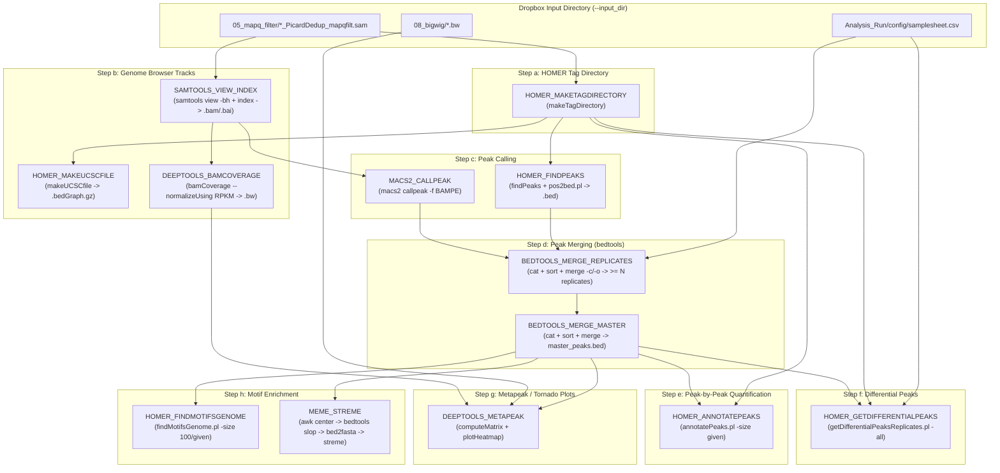

# CUT&RUN Downstream Analysis Nextflow Pipeline Plan

## 1. Overview & Architectural Goals

This plan outlines the design and implementation of an opinionated Nextflow DSL2 pipeline for **CUT&RUN Downstream Analysis** based on [docs/Downstream_analysis_steps.md](file:///Users/dan/Code/NextFlow/Cut_And_Run_Analysis/docs/Downstream_analysis_steps.md).

### Core Principles
- **Dropbox Input + Local Execution & Output:**
  - **Input Data (`params.input_dir`):** Read directly from the shared Dropbox folder (`/Users/dan/UMass Medical School Dropbox/Daniel Higgins/Walker_lab_shared/Bioinformatics_parent/cut_run103026`). Docker is configured to mount `/Users/dan/UMass Medical School Dropbox` so containerized processes can follow Nextflow symlinks directly without duplicating ~50 GB of data.
  - **Local `work/` & `results/`:** Executed from `/Users/dan/Code/NextFlow/Cut_And_Run_Analysis/Analysis_Run` so all high-churn Nextflow `work/` directories and published `results/` stay on the local SSD outside of Dropbox sync.
- **Modular & Toggle-Driven Execution:** Every downstream step (`a` through `h` in `Downstream_analysis_steps.md`) is controlled via boolean `run_*` flags in `Analysis_Run/config/experiment.config`.
- **Dual Input Resolution (Compute or Reuse):** Each downstream stage can either consume the in-memory output channel from the preceding pipeline step **or** load pre-existing outputs directly from `params.input_dir` (`05_mapq_filter/`, `07_ucsc/`, `08_bigwig/`) when earlier steps are toggled off.
- **Lean `nf-core` Best Practices:** Uses concise local DSL2 modules (`modules/local/`) and `nf-core` conventions configured centrally via `conf/base.config` and `conf/modules.config`.

---

## 2. Upstream Data Layout & Input Channels

The pipeline reads upstream processed files directly from `params.input_dir` (e.g., `/Users/dan/UMass Medical School Dropbox/Daniel Higgins/Walker_lab_shared/Bioinformatics_parent/cut_run103026`):

```text
cut_run103026/
├── All_tissues.xlsx
├── fastq/
├── 02_fastqc/
├── 02_multiqc/
├── 03_align/
├── 04_dedup/
├── 05_mapq_filter/          # *_PicardDedup_mapqfilt.sam (and 01_trim/)
├── 07_ucsc/                 # <sample_id>/<sample_id>.ucsc.bedGraph.gz (Step b - HOMER)
└── 08_bigwig/               # <sample_id>.bw (Step b - deepTools)
```

> [!IMPORTANT]
> Ensure that any input directories in Dropbox used by active pipeline steps (especially `05_mapq_filter/` and `08_bigwig/`) are set to **"Make available offline"** in Finder so Dropbox Smart Sync does not leave `0B` online-only placeholder files (`com.dropbox.placeholder`).

### Sample & Condition Metadata (`Analysis_Run/config/samplesheet.csv`)
Steps `d`, `e`, and `f` (replicate peak merging, condition master peak set creation, and `getDifferentialPeaksReplicates.pl`) require knowing which samples belong to which biological condition and replicate group, as well as treatment vs. background contrasts.

We support two input modes:
1. **Glob Discovery Mode (Single-sample steps `a`, `b`, `c`, `g`, `h`):** Discovers SAM/BAM, Tag Directories, BigWigs, or BED files via configurable globs rooted at `params.input_dir`.
2. **Samplesheet / Contrast Mode (Group-aware steps `d`, `e`, `f`):** Reads `Analysis_Run/config/samplesheet.csv` (and `params.diff_contrasts` in `experiment.config`) defining:
   - `sample_id`: Sample prefix (e.g., `L9254-0001-0001_S141_L004`)
   - `condition`: Biological group (e.g., `cond1`, `cond2`)
   - `replicate`: Replicate number (`1`, `2`, `3`)
   - `control_id` *(optional)*: Optional IgG sample ID if calling peaks against background

---

## 3. Pipeline Architecture & Workflow DAG



---

## 4. Toggle Configuration Design (`Analysis_Run/config/experiment.config`)

`Analysis_Run/config/experiment.config` exposes granular switches and parameters for every step in `Downstream_analysis_steps.md`:

```groovy
params {
    // =========================================================================
    // Experiment & Input / Output Paths
    // =========================================================================
    experiment                     = "cut_run103026"
    input_dir                      = "/Users/dan/UMass Medical School Dropbox/Daniel Higgins/Walker_lab_shared/Bioinformatics_parent/${params.experiment}"
    outdir                         = "${launchDir}/results/${params.experiment}"
    samplesheet                    = "${launchDir}/config/samplesheet.csv"

    // =========================================================================
    // Step Toggles (Turn individual downstream outputs on/off)
    // =========================================================================
    // Pre-step (Optional TF fragment filtering <= 120bp)
    run_fragment_filter_120bp      = false

    // Step a: Making a tag directory in HOMER
    run_homer_maketagdirectory     = true

    // Step b: Making files for viewing on the genome browser
    run_homer_makeucscfile         = false
    run_sam_to_bam                 = true
    run_deeptools_bamcoverage      = false

    // Step c: Calling peaks (MACS2 and/or HOMER)
    run_macs2_callpeak             = true
    run_homer_findpeaks            = false

    // Step d: Merging peak files using bedtools
    run_merge_replicate_peaks      = true
    run_merge_master_peaks         = true

    // Step e: Peak-by-peak analysis using HOMER
    run_homer_annotatepeaks        = true

    // Step f: Calling differential peaks using HOMER
    run_homer_diffpeaks            = false

    // Step g: Making metapeak plots (tornado plots) with deepTools
    run_deeptools_metapeak         = true

    // Step h: Looking for enriched motifs in peaks
    run_homer_findmotifs           = true
    run_meme_streme                = false

    // =========================================================================
    // Pre-existing Input Globs (Resolved from input_dir when toggles are false)
    // =========================================================================
    input_sam                      = "${params.input_dir}/05_mapq_filter/*_PicardDedup_mapqfilt.sam"
    input_bam                      = "${params.outdir}/05_bam/*.bam"
    input_tagdirs                  = "${params.outdir}/06_tag_dir/*_tagdir"
    input_ucsc_bedgraph            = "${params.input_dir}/07_ucsc/**/*.ucsc.bedGraph.gz"
    input_bigwig                   = "${params.input_dir}/08_bigwig/*.bw"
    input_peaks_bed                = "${params.outdir}/10_merged_peaks/master/master_peaks.bed"

    // =========================================================================
    // Tool-Specific Parameters
    // =========================================================================
    // Genome Reference Settings (C. elegans defaults, customizable to mm10/hg38/dm6)
    genome_name                    = "ce11"                  // Used by HOMER (e.g., ce11, mm10, hg38, dm6)
    genome_fasta                   = null                    // Path to GENOME.fa (required for MEME STREME)
    chrom_sizes                    = null                    // Path to GENOME.chrom.sizes (required for MEME STREME)

    // Step b: deepTools bamCoverage
    bamcoverage_norm               = "RPKM"

    // Step c: MACS2 parameters
    macs2_gsize                    = "ce"                    // hs, mm, ce, dm, or numeric size
    macs2_format                   = "BAMPE"
    macs2_qvalue                   = 0.01
    macs2_broad                    = false                   // Toggle --broad flag

    // Step c: HOMER findPeaks parameters
    homer_peak_style               = "factor"                // 'factor' (narrow TF) or 'histone' (broad)

    // Step d: bedtools replicate & condition peak merging
    active_peak_caller             = "macs2"                 // Which peaks feed into Step d ('macs2' or 'homer')
    min_replicate_overlap          = 2                       // Keep peaks present in >= N replicates per condition

    // Step e: HOMER annotatePeaks
    annotatepeaks_size             = "given"                 // -size given

    // Step f: HOMER getDifferentialPeaksReplicates contrasts
    // List of maps: [ [ id: 'cond2_vs_cond1', treatment: 'cond2', background: 'cond1' ] ]
    diff_contrasts                 = []

    // Step g: deepTools computeMatrix & plotHeatmap
    metapeak_upstream              = 2000                    // -b BP_UPSTREAM
    metapeak_downstream            = 2000                    // -a BP_DOWNSTREAM
    metapeak_reference_point       = "center"                // --referencePoint center
    heatmap_colormap               = "inferno"               // --colorMap inferno
    heatmap_interpolation          = "nearest"               // --interpolationMethod nearest

    // Step h: Motif discovery (HOMER & MEME STREME)
    homer_motif_size               = "100"                   // Numeric (e.g. 100) or "given"
    meme_slop_left                 = 50                      // -l 50
    meme_slop_right                = 49                      // -r 49 (produces 100bp window centered on peak)
    meme_streme_nmotifs            = 20                      // --nmotifs 20
}
```

---

## 5. Module Specifications (Step-by-Step)

### Optional Pre-Step: Fragment Size Filtering ($\le$ 120 bp for TFs)
- **Module:** `modules/local/samtools_filter_frags/main.nf`
- **Toggle:** `params.run_fragment_filter_120bp`
- **Command:**
  ```bash
  samtools view -h ${sam} | awk '/^@/ || ($9 <= 120 && $9 >= 1) || ($9 >= -120 && $9 <= -1)' > ${prefix}_1_120.sam
  ```
- **Output:** `tuple val(meta), path("*_1_120.sam")` published to `05_mapq_filter_120bp/`.

### Step a: Making a Tag Directory in HOMER
- **Module:** `modules/local/homer_maketagdirectory/main.nf`
- **Toggle:** `params.run_homer_maketagdirectory`
- **Input:** `tuple val(meta), path(sam_or_bam)`
- **Command:**
  ```bash
  makeTagDirectory ${prefix}_tagdir/ ${sam_or_bam} $args
  ```
- **Output:** `tuple val(meta), path("${prefix}_tagdir")` published to `06_tag_dir/`.
- **Fallback when `false`:** Loads existing tag directories from `params.input_tagdirs`.

### Step b: Making Files for Viewing on the Genome Browser
1. **HOMER bedGraph (`HOMER_MAKEUCSCFILE`)**
   - **Module:** `modules/local/homer_makeucscfile/main.nf`
   - **Toggle:** `params.run_homer_makeucscfile`
   - **Input:** `tuple val(meta), path(tagdir)`
   - **Command:** `makeUCSCfile ${tagdir} -o auto $args`
   - **Output:** `tuple val(meta), path("${tagdir}/*.ucsc.bedGraph.gz")` published to `07_ucsc/${meta.id}/`.
2. **SAM to Indexed BAM (`SAMTOOLS_VIEW_INDEX`)**
   - **Module:** `modules/local/samtools_view_index/main.nf`
   - **Toggle:** `params.run_sam_to_bam`
   - **Input:** `tuple val(meta), path(sam)`
   - **Command:**
     ```bash
     samtools view -@ $task.cpus -bh ${sam} > ${prefix}.bam
     samtools index -@ $task.cpus ${prefix}.bam
     ```
   - **Output:** `tuple val(meta), path("${prefix}.bam"), path("${prefix}.bam.bai")` published to `05_bam/`.
3. **deepTools BigWig (`DEEPTOOLS_BAMCOVERAGE`)**
   - **Module:** `modules/local/deeptools_bamcoverage/main.nf`
   - **Toggle:** `params.run_deeptools_bamcoverage`
   - **Input:** `tuple val(meta), path(bam), path(bai)`
   - **Command:** `bamCoverage -b ${bam} --normalizeUsing ${params.bamcoverage_norm} -p $task.cpus -o ${prefix}.bw $args`
   - **Output:** `tuple val(meta), path("${prefix}.bw")` published to `08_bigwig/`.
   - **Fallback when `false`:** Loads existing `.bw` files from `params.input_bigwig` (e.g., Dropbox `08_bigwig/*.bw`) for Step `g`.

### Step c: Calling Peaks (MACS2 & HOMER)
1. **MACS2 Peak Calling (`MACS2_CALLPEAK`)**
   - **Module:** `modules/local/macs2_callpeak/main.nf`
   - **Toggle:** `params.run_macs2_callpeak`
   - **Input:** `tuple val(meta), path(bam), path(bai)`
   - **Command:**
     ```bash
     macs2 callpeak \
       -t ${bam} \
       -g ${params.macs2_gsize} \
       -f ${params.macs2_format} \
       -n ${prefix} \
       -q ${params.macs2_qvalue} \
       ${broad_arg} \
       $args
     ```
   - **Output:** `narrowPeak` (or `broadPeak`), `.xls`, and `_summits.bed` (or `.gappedPeak`) published to `09_peaks/macs2/`.
2. **HOMER Peak Calling (`HOMER_FINDPEAKS`)**
   - **Module:** `modules/local/homer_findpeaks/main.nf`
   - **Toggle:** `params.run_homer_findpeaks`
   - **Input:** `tuple val(meta), path(tagdir)`
   - **Command:**
     ```bash
     findPeaks ${tagdir} -style ${params.homer_peak_style} -o ${prefix}_peaks.txt $args
     pos2bed.pl ${prefix}_peaks.txt > ${prefix}_peaks.bed
     ```
   - **Output:** `tuple val(meta), path("${prefix}_peaks.txt"), path("${prefix}_peaks.bed")` published to `09_peaks/homer/`.

### Step d: Merging Peak Files Using `bedtools`
1. **Per-Condition Replicate Peak Filtering (`BEDTOOLS_MERGE_REPLICATES`)**
   - **Module:** `modules/local/bedtools_merge_replicates/main.nf`
   - **Toggle:** `params.run_merge_replicate_peaks`
   - **Input:** Grouped by `meta.condition`: `tuple val(condition), path(rep_beds)`
   - **Logic:** Standardizes replicate peak files to 3-column BED + replicate filename, sorts (`bedtools sort`), merges while counting distinct replicates (`bedtools merge -c 4 -o count_distinct`), and keeps peaks present in $\ge$ `params.min_replicate_overlap` replicates.
   - **Output:** `tuple val(condition), path("${condition}_replicated_peaks.bed")` published to `10_merged_peaks/replicates/`.
2. **Inclusive Master Peak Set Across Conditions (`BEDTOOLS_MERGE_MASTER`)**
   - **Module:** `modules/local/bedtools_merge_master/main.nf`
   - **Toggle:** `params.run_merge_master_peaks`
   - **Input:** All condition-merged BED files collected into a single channel
   - **Command:**
     ```bash
     cat ${condition_beds} | cut -f1-3 | bedtools sort -i stdin | bedtools merge -i stdin > master_peaks.bed
     ```
   - **Output:** `path("master_peaks.bed")` published to `10_merged_peaks/master/`.
   - **Fallback when `false`:** Uses `params.input_peaks_bed` for Steps `e`, `f`, `g`, `h`.

### Step e: Peak-by-Peak Analysis Using HOMER (`annotatePeaks.pl`)
- **Module:** `modules/local/homer_annotatepeaks/main.nf`
- **Toggle:** `params.run_homer_annotatepeaks`
- **Input:** `path(master_peaks_bed)`, `path(all_tagdirs)`, `val(genome_name)`
- **Command:**
  ```bash
  annotatePeaks.pl ${master_peaks_bed} \
    ${genome_name} \
    -size ${params.annotatepeaks_size} \
    -d ${all_tagdirs} \
    $args > annotated_peaks_quantification.txt
  ```
- **Output:** `path("annotated_peaks_quantification.txt")` published to `11_peak_quantification/`.

### Step f: Calling Differential Peaks Using HOMER (`getDifferentialPeaksReplicates.pl`)
- **Module:** `modules/local/homer_getdifferentialpeaks/main.nf`
- **Toggle:** `params.run_homer_diffpeaks`
- **Input:** Contrast tuple `tuple val(contrast_meta), path(treatment_tagdirs), path(background_tagdirs), path(master_peaks_bed), val(genome_name)`
- **Command:**
  ```bash
  getDifferentialPeaksReplicates.pl \
    -t ${treatment_tagdirs} \
    -b ${background_tagdirs} \
    -p ${master_peaks_bed} \
    -genome ${genome_name} \
    -all \
    $args > ${contrast_meta.id}_differential_peaks.txt
  ```
- **Output:** `tuple val(contrast_meta), path("*_differential_peaks.txt")` published to `12_differential_peaks/`.

### Step g: Making Metapeak Plots (Tornado Plots) with `deepTools`
- **Module:** `modules/local/deeptools_metapeak/main.nf`
- **Toggle:** `params.run_deeptools_metapeak`
- **Input:** `path(bigwigs)`, `path(peaks_bed)`
- **Command:**
  ```bash
  computeMatrix reference-point \
    -S ${bigwigs} \
    -R ${peaks_bed} \
    -a ${params.metapeak_downstream} \
    -b ${params.metapeak_upstream} \
    --referencePoint ${params.metapeak_reference_point} \
    -p $task.cpus \
    $args \
    -o ${prefix}_matrix.mat.gz

  plotHeatmap \
    -m ${prefix}_matrix.mat.gz \
    --colorMap ${params.heatmap_colormap} \
    --interpolationMethod ${params.heatmap_interpolation} \
    $args2 \
    -o ${prefix}_metapeak_heatmap.pdf
  ```
- **Output:** `path("*_matrix.mat.gz")` and `path("*_metapeak_heatmap.pdf")` published to `13_metapeak_plots/`.

### Step h: Looking for Enriched Motifs in Peaks
1. **HOMER Motif Enrichment (`HOMER_FINDMOTIFSGENOME`)**
   - **Module:** `modules/local/homer_findmotifsgenome/main.nf`
   - **Toggle:** `params.run_homer_findmotifs`
   - **Input:** `tuple val(meta), path(peaks_bed), val(genome_name)`
   - **Command:**
     ```bash
     findMotifsGenome.pl ${peaks_bed} \
       ${genome_name} \
       ${prefix}_homer_motifs/ \
       -size ${params.homer_motif_size} \
       -p $task.cpus \
       $args
     ```
   - **Output:** `tuple val(meta), path("${prefix}_homer_motifs/")` published to `14_motifs/homer/`.
2. **MEME Suite STREME Motif Enrichment (`MEME_STREME`)**
   - **Module:** `modules/local/meme_streme/main.nf`
   - **Toggle:** `params.run_meme_streme`
   - **Input:** `tuple val(meta), path(peaks_bed), path(chrom_sizes), path(genome_fasta)`
   - **Command:**
     ```bash
     awk 'BEGIN{FS=OFS="\t"} !/^#/ {print $1, int(($2 + $3)/2), int(($2 + $3)/2) + 1}' ${peaks_bed} | \
       bedtools slop -i stdin -g ${chrom_sizes} -l ${params.meme_slop_left} -r ${params.meme_slop_right} > ${prefix}_centers_100bp.bed

     bed2fasta -o ${prefix}_centers_100bp.fa ${prefix}_centers_100bp.bed ${genome_fasta}

     streme --oc ${prefix}_streme_motifs \
       --nmotifs ${params.meme_streme_nmotifs} \
       --dna \
       --p ${prefix}_centers_100bp.fa \
       $args
     ```
   - **Output:** Centered 100bp BED, FASTA, and STREME output directory published to `14_motifs/meme_streme/`.

---

## 6. Target Project Directory Tree

```text
Cut_And_Run_Analysis/
├── .gitignore
├── .nf-core.yml
├── Makefile                                         # Task runner (install, test, lint, dry-run, run)
├── README.md
├── plan.md                                          # This architectural & implementation plan
├── main.nf                                          # Entrypoint: channel resolution & validation
├── modules.json
├── nextflow.config                                  # Global defaults & execution profiles
├── Analysis_Run/                                    # Execution workspace (launchDir)
│   ├── run.sh                                       # Execution wrapper script
│   ├── config/
│   │   ├── experiment.config                        # Step toggles & experiment parameters
│   │   └── samplesheet.csv                          # Sample-to-condition mapping
│   ├── work/                                        # Local Nextflow work directory (gitignored)
│   └── results/                                     # Local published outputs (gitignored)
├── assets/
├── bin/
│   └── normalize_homer_peaks.py                     # Optional helper for tags/kb calculation
├── conf/
│   ├── base.config                                  # Process resource labels
│   └── modules.config                               # Per-module ext.args and publishDir rules
├── docs/
│   └── Downstream_analysis_steps.md
├── modules/
│   ├── local/
│   │   ├── samtools_filter_frags/main.nf
│   │   ├── samtools_view_index/main.nf
│   │   ├── homer_maketagdirectory/main.nf
│   │   ├── homer_makeucscfile/main.nf
│   │   ├── deeptools_bamcoverage/main.nf
│   │   ├── macs2_callpeak/main.nf
│   │   ├── homer_findpeaks/main.nf
│   │   ├── bedtools_merge_replicates/main.nf
│   │   ├── bedtools_merge_master/main.nf
│   │   ├── homer_annotatepeaks/main.nf
│   │   ├── homer_getdifferentialpeaks/main.nf
│   │   ├── deeptools_metapeak/main.nf
│   │   ├── homer_findmotifsgenome/main.nf
│   │   └── meme_streme/main.nf
│   └── nf-core/
└── workflows/
    └── cutandrun.nf                                 # Core toggle-driven workflow orchestration
```

---

## 7. Phased Implementation Roadmap

### Phase 1: Workspace & Configuration Scaffolding (Current)
1. Update `.gitignore` to ignore `Analysis_Run/work/`, `Analysis_Run/results/`, and `Analysis_Run/.nextflow*` while tracking `Analysis_Run/config/` and `Analysis_Run/run.sh`.
2. Create `Analysis_Run/config/experiment.config`, `Analysis_Run/config/samplesheet.csv`, and `Analysis_Run/run.sh`.
3. Update `nextflow.config` and `conf/modules.config` with Dropbox volume mounts, default toggle parameters, and numbered output publishing directories (`05_bam`, `06_tag_dir`, `07_ucsc`, `08_bigwig`, `09_peaks`, `10_merged_peaks`, `11_peak_quantification`, `12_differential_peaks`, `13_metapeak_plots`, `14_motifs`).
4. Add root `Makefile` for standardized execution (`make dry-run`, `make run`, `make lint`, `make clean`).

### Phase 2: Core Preparation & Browser Track Modules (Steps `a` & `b`)
1. Implement `SAMTOOLS_FILTER_FRAGS` (optional $\le$ 120bp TF filter).
2. Implement `HOMER_MAKETAGDIRECTORY` (Step `a`).
3. Implement `HOMER_MAKEUCSCFILE`, `SAMTOOLS_VIEW_INDEX`, and `DEEPTOOLS_BAMCOVERAGE` (Step `b`).
4. Wire dual-source channel resolution in `main.nf` / `workflows/cutandrun.nf` so existing `05_mapq_filter/*.sam`, `07_ucsc/`, and `08_bigwig/*.bw` in Dropbox `cut_run103026` can be ingested directly when upstream toggles are `false`.

### Phase 3: Peak Calling & Replicate/Master Peak Merging (Steps `c` & `d`)
1. Implement `MACS2_CALLPEAK` (supporting narrow/broad modes and optional IgG background) and `HOMER_FINDPEAKS` (`factor`/`histone` styles + `pos2bed.pl`).
2. Implement `BEDTOOLS_MERGE_REPLICATES` (filtering peaks present in $\ge N$ replicates per condition) and `BEDTOOLS_MERGE_MASTER` (inclusive merge across conditions).

### Phase 4: Quantification, Differential Analysis, Visualization & Motifs (Steps `e`, `f`, `g`, `h`)
1. Implement `HOMER_ANNOTATEPEAKS` (Step `e`) and optional `bin/normalize_homer_peaks.py` for peak-width normalization (`tags_per_kb`).
2. Implement `HOMER_GETDIFFERENTIALPEAKS` (Step `f`) driven by contrast definitions.
3. Implement `DEEPTOOLS_METAPEAK` (`computeMatrix` + `plotHeatmap`, Step `g`) capable of running directly on `08_bigwig/*.bw` + any BED file.
4. Implement `HOMER_FINDMOTIFSGENOME` and `MEME_STREME` (Step `h`).

### Phase 5: Validation & Dry-Run Verification
1. Verify channel wiring and toggle combinations from `Analysis_Run/` using `make dry-run` (`nextflow -c config/experiment.config run ../ -preview`).
